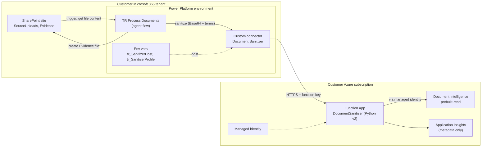
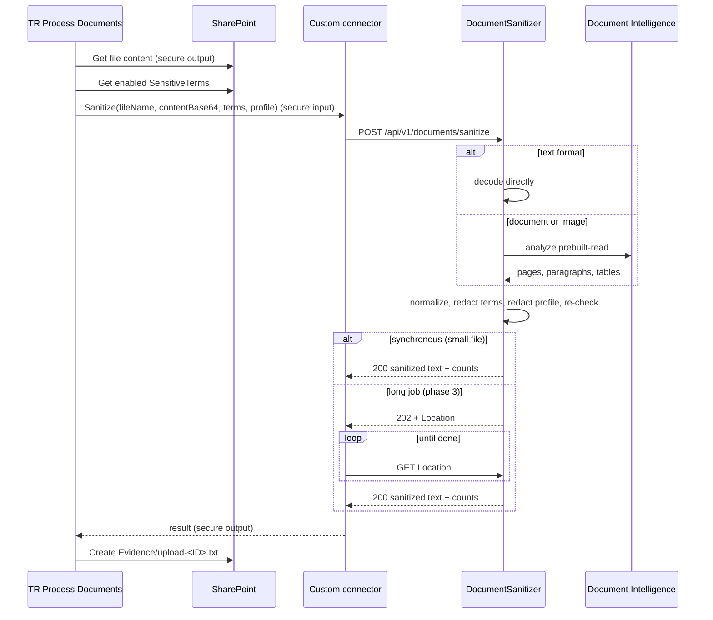

# Document Sanitizer add-on: design

An Azure Function that turns an uploaded document into plain text or Markdown and redacts sensitive data before the text reaches a shared SharePoint library. Flows in any vertical call it. The first caller is Trend Researcher's `TR Process Documents`, which in 1.2.0.0 reads public plain-text files only.

- **Origin:** `brainstorm/azure-function-document-conversion-pii-redaction-design.md`, adapted to this repo's portability, secrets and packaging rules.
- **Status:** design only. An implementation plan comes when a customer needs private uploads or binary formats.
- **How it ships:** see [ADR-001](adr-001-document-sanitizer-distribution.md). In short, the customer deploys the function into their own Azure subscription, and the vertical's solution carries the custom connector that calls it.

## 1. What it does

1. Receives one document from a flow, as Base64.
2. Detects the real file type.
3. Extracts the text:
   - text formats are decoded directly;
   - PDF, Office files, HTML and images go through Azure AI Document Intelligence `prebuilt-read`, which includes OCR.
4. Normalizes the result to Markdown or plain text, as UTF-8 with LF line endings.
5. Redacts:
   - the caller's **literal terms**, case-insensitively, longest first;
   - the **regex profile** held on the server.
6. Returns only the sanitized text and counts, never matched values.

The flow keeps all SharePoint access: it reads the file, calls the function and writes the result. The function needs no Microsoft Graph or SharePoint permissions.

### Supported input

| Kind | Formats | Extractor |
|---|---|---|
| Text | TXT, CSV, MD, JSON, XML, LOG | direct decoding (UTF-8, UTF-8 BOM, UTF-16, configured fallback) |
| HTML | HTML, HTM | HTML parser; scripts, styles, comments and hidden elements dropped |
| Documents | PDF (digital and scanned), DOCX, XLSX, PPTX | Document Intelligence `prebuilt-read` |
| Images | JPEG, PNG, BMP, TIFF, HEIF | Document Intelligence OCR |

These inputs are rejected with `415` or `422`:
- legacy DOC, XLS and PPT;
- encrypted or password-protected files;
- macro-enabled formats;
- corrupt files.

## 2. Components



## 3. Request flow



## 4. API contract

### Request

`POST /api/v1/documents/sanitize`

```json
{
  "fileName": "CustomerReport.pdf",
  "contentType": "application/pdf",
  "contentBase64": "JVBERi0xLjQK...",
  "outputFormat": "markdown",
  "profile": "default-pii",
  "terms": [
    {"term": "Exact Customer Corp", "replacement": "[CUSTOMER]"},
    {"term": "Project Falcon", "replacement": "[PROJECT]"}
  ],
  "correlationId": "<workflow run id>"
}
```

- `fileName` (required) and `contentType` (recommended): the function uses them only as hints next to the file signature.
- `outputFormat`: `markdown` or `text`.
- `profile`: the name of a server-side regex profile. Callers never send regex.
- `terms` (optional): literal strings from the vertical's `SensitiveTerms` list.
  - **Changed from the brainstorm design.** Each customer manages its terms in SharePoint, not in the function's configuration.
  - The function escapes each term and matches it case-insensitively on word boundaries, longest first. Terms are never interpreted as regex.
  - Limits: 500 terms, 200 characters each.
- `correlationId`: the flow run name, for diagnostics.

### Response (`200`)

```json
{
  "status": "completed",
  "outputContentType": "text/markdown; charset=utf-8",
  "sanitizedContentBase64": "IyBDdXN0b21lciBSZXBvcnQKLi4u",
  "metadata": {
    "detectedType": "pdf",
    "extractor": "document-intelligence-prebuilt-read",
    "pageCount": 12,
    "redactionCounts": {"term": 5, "email": 14, "phone": 8},
    "warnings": []
  },
  "correlationId": "<workflow run id>"
}
```

The response has no output file name. Each caller names its own files: Trend Researcher writes `Evidence/upload-<ID>.txt` so that original names never collide or leak.

### Errors

The error body is `{"status": "failed", "error": {"code", "message"}, "correlationId"}`.

| Status | Meaning | The flow retries? |
|---|---|---|
| 400 | malformed request or invalid Base64 | no |
| 401 / 403 | bad or missing key | no |
| 413 | file or extracted text over the limit | no |
| 415 | type not supported | no |
| 422 | accepted but not extractable (encrypted, corrupt, empty) | no |
| 429 | throttled; honor `Retry-After` | yes |
| 500 | unexpected | no |
| 502 / 503 / 504 | a dependency is unavailable | yes |

On any failure the flow **fails closed**: the SourceItem becomes `MetadataOnly` and no content reaches Evidence.

## 5. Limits and timing

- **Synchronous calls must finish in under about 100 s.** Power Automate stops waiting on a synchronous outbound request after 120 s, which is stricter than the function platform's 230 s HTTP limit.
- **Initial application limits:**
  - 10 MB per file;
  - 5 MB of extracted text;
  - 100 PDF pages in synchronous mode.

  All are configurable.
- **Large or OCR-heavy files (phase 3)** use the asynchronous pattern: `202 Accepted` with a `Location` header, then the caller polls. Power Automate's HTTP actions follow this pattern without extra actions. Confirm that a custom-connector action in an agent flow does the same before relying on it.

## 6. Redaction engine

Rules are applied in a fixed order:
1. Unicode and line-ending normalization.
2. Caller terms (longest first, case-insensitive, word-bounded).
3. Specific identifiers from the profile, such as account or ID formats.
4. Email.
5. Phone.
6. Money, when enabled.
7. A post-redaction check that no term or rule still matches. If one does, the response is `422 REDACTION_INCOMPLETE`, and the caller fails closed.

Each profile is a named set of rules in `config/redaction-profiles.json` (`id`, `pattern`, `replacement`, `enabled`). Requirements:
- Patterns are compiled once per instance and run with a timeout. Patterns prone to catastrophic backtracking are rejected when the configuration loads.
- Replacements use bracketed placeholders (`[REDACTED_EMAIL]`) that no later rule can match.
- Only counts are recorded: never matched values.
- Every rule has positive and negative unit tests, plus a regression corpus with the customer's real document formats. Phone and money patterns produce false positives until they are tuned against that corpus.

Regex can't reliably find personal names, postal addresses or free-form sensitive descriptions. An entity-recognition service (for example Azure AI Language PII detection) is a possible later phase, kept separate from this deterministic MVP.

## 7. Security and data protection

The function handles unredacted private data. These controls are mandatory:

- **Authentication, MVP: a function key.**
  - The custom connector uses API-key security: header `x-functions-key`.
  - The customer pastes the key when creating the connection.
  - The key lives in the Power Platform connection, never in the solution, the repo or an environment variable.
- **Authentication, hardening: Microsoft Entra ID.** Turn on App Service authentication, and switch the connector to OAuth with an app registration that only the flow's connection can use.
- **Managed identity** for Document Intelligence and any storage. The app settings hold no service keys.
- **Logs** hold only the correlation ID, type, byte count, duration, extractor, status and counts.
  - Request-body collection in Application Insights is turned off.
  - No raw document goes to a dead-letter queue.
- **Temporary storage** (phase 3 only): a private Blob container with lifecycle deletion within 24 h, reachable only through the managed identity.
- **Network:** private endpoints and restricted outbound traffic where the customer's policy requires them.
- **In the flow:** every action that carries file content or sanitized text (`Get file content`, the sanitize call, any Compose holding the result) has **secure inputs and outputs** on, so run history never shows document text. The repo's flow validator should enforce this for any action that uses the sanitizer connector.
- **Compliance:** personal, financial or health data in documents puts the customer's regional and industry rules on the Azure resources too. The deployment uses the customer's region.

## 8. Function project layout

The code lives at `addons/document-sanitizer/` in this repo, beside the verticals. It is released on its own; see the ADR.

```text
addons/document-sanitizer/
  function_app.py               HTTP trigger (Python v2 programming model)
  host.json
  requirements.txt              azure-functions, azure-ai-documentintelligence, azure-identity,
                                beautifulsoup4, markdownify, charset-normalizer
  local.settings.example.json   placeholders only; the real file is git-ignored
  app/
    api.py  models.py  type_detection.py
    extraction/   router.py  text_extractor.py  html_extractor.py  document_intelligence.py
    normalization/ markdown.py  plain_text.py
    redaction/    engine.py  terms.py  profiles.py  validators.py
    telemetry.py
  config/redaction-profiles.json
  infra/
    main.bicep                  Function App, storage, App Insights, Document Intelligence, identity
    main.parameters.example.json
  connector/
    apiDefinition.swagger.json  the custom connector's OpenAPI definition, copied into vertical solutions
  tests/
    test_type_detection.py  test_extractors.py  test_redaction.py  test_terms.py  fixtures/
```

## 9. Integration with Trend Researcher

`TR Process Documents` 1.2.0.0 already has the two places where the sanitizer plugs in:

- **The else branch of `If_Text_File`** (binary or oversized files). If `tr_SanitizerHost` is set, the flow calls the sanitizer. If it isn't, it keeps today's `MetadataOnly` behavior.
- **A new private branch beside `If_Public_Path`** for `/SourceUploads/PrivateData/`. It runs only when the sanitizer is configured. Otherwise private files are ignored, as they are today.

Idempotency stays in the flow: the existing `ItemKey` (`<Source ID>|<file item ID>`) dedupe runs before the sanitizer call, so the function never sees the same upload twice.

New SourceItems columns, needed only when the add-on is enabled: `WasRedacted` (Boolean) and `RedactionSummary` (Note, counts only).

## 10. Delivery phases

1. **Synchronous core:**
   - text, HTML and Document Intelligence extraction;
   - caller terms, plus email and phone rules;
   - function-key authentication;
   - Bicep template and custom connector;
   - Trend Researcher integration.
2. **Hardening:**
   - Entra ID authentication;
   - private networking;
   - more profiles;
   - the regression corpus;
   - stricter file-signature checks;
   - rate limits;
   - alerts that never include content.
3. **Large files:**
   - Blob staging;
   - a queue or Durable Functions;
   - the `202` job API and status endpoint;
   - expiring results and cleanup.

## 11. Open questions

- Premium-connector licensing: do the customer's Copilot Studio agent flows cover custom connectors?
- Does the agent-flow custom-connector action follow `202` + `Location` polling the way the HTTP action does?
- Will the customer allow private originals to leave SharePoint for their own Azure subscription at all? Some data policies forbid it.
- Is Document Intelligence's per-page cost acceptable at the expected volume, or is the local-parsing fast path needed? That path uses python-docx, python-pptx, openpyxl and PyMuPDF for digital files, and falls back to Document Intelligence.
