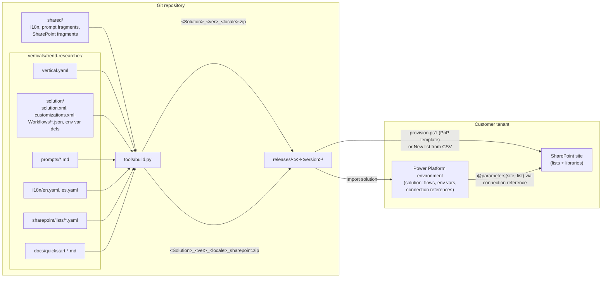
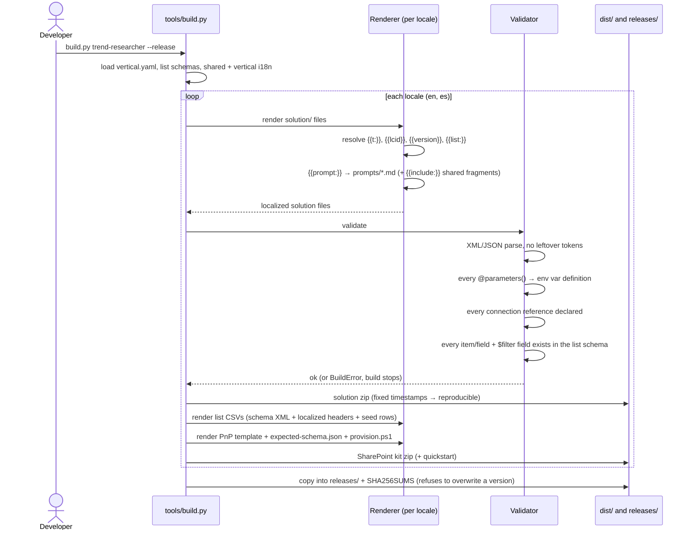

# Architecture and conventions

## Why this shape

Microsoft solutions can't carry SharePoint lists, and flows built in the designer hardcode tenant-specific values: the site URL, list GUIDs, content-type IDs and Excel-generated column names. This repo keeps every vertical as **source plus a build step**, so one source tree produces a package that imports cleanly into any customer tenant, in any supported language.

This follows the same pattern as Microsoft's multi-solution repos (CoE Starter Kit, Contoso Real Estate): one folder per solution, settings per environment kept out of source control, and release zips per solution. Two deliberate differences:

1. **Source layout = the exported zip layout**, not the `pac solution unpack` layout. A fresh UI export can be diffed directly against `verticals/<v>/solution/`, and packing is a plain zip that works on Linux without the `pac` CLI.
2. **Per-locale builds.** Each zip carries one base language (1033 or 3082). A Spanish-base environment never has to accept an English base solution or have the English language pack enabled.

## Components

## Build sequence

## Portability rules

These rules are what make a package work "out of the box" in another tenant. The build enforces the first three.

| Rule | Why |
|---|---|
| **No tenant literals in flows.** Site URL and list identifiers come from environment variables via `@parameters('<Display> (<schema>)')`. | Values are set per environment at import time. |
| **SharePoint internal column names are a contract.** Flows use internal names (`field_3`, `PublishedAt`). List schemas in `sharepoint/lists/*.yaml` define them. The PnP template recreates them exactly in every tenant; the CSV kit is the no-tools alternative, and `provision.ps1 -VerifyOnly` checks either. Never rename an internal name; change only display labels. | Display names are localized and can be edited by users. Internal names cannot change after a column is created. |
| **Status values are English codes** (`Ready`, `Classified`, `Digest`, `High`, `Near`). The UI and reports translate them; the data does not. | Flows filter on these values, and translation must not break filters. |
| **No content-type IDs, connection IDs or user IDs in actions.** | They are tenant-specific. |
| **Library URL names stay in English** (`/Evidence`). Only the display title is localized. | Flows write to the URL path. |
| **Prompts live in `prompts/` with a version** in `vertical.yaml`. The version is written to `Signals.PromptVersion` and is part of `AnalysisKey`. | Lets you tell which prompt produced a classification. |

## SharePoint provisioning

Solutions can't carry SharePoint lists, and SharePoint only lets you choose a column's internal name when the column is created. Each SharePoint kit therefore offers two ways to create the site's lists and libraries, both generated from `sharepoint/lists/*.yaml`:

| | `lists/*.csv` (CSV with schema) | `pnp/` (PnP provisioning template) |
|---|---|---|
| Who runs it | any site owner, in the browser (**New → List → From CSV**) | IT, with PowerShell 7.4+, PnP.PowerShell and an Entra ID app registration |
| Internal names | carried in the schema line; not guaranteed by SharePoint, so verify them | guaranteed: PnP creates list fields with `AddFieldInternalNameHint` |
| Libraries, upgrades | by hand | created by the template; re-running adds new columns (`KeyColumn` + `UpdateBehavior="Skip"` keeps seed rows) |
| Verification | manual table in the quickstart, or `provision.ps1 -VerifyOnly` | automatic at the end of `provision.ps1` |

- `pnp/sharepoint-template.pnp.xml` follows PnP schema 2022-09. The tests validate it against the vendored XSD in `tools/schemas/`.
- Lists are created at stable English URLs (`Lists/Sources`) with localized titles. Libraries use their `urlName`.
- `pnp/expected-schema.json` drives the verification. It finds lists by title first, then by URL, so it also checks CSV-created lists.
- `tools/tests/pnp_mock/` is a stand-in `PnP.PowerShell` module. It lets the tests run the real `provision.ps1` against good and broken sites without a tenant (they run when `pwsh` is on PATH, as on GitHub's Ubuntu runners).

## The designer graph

Flows exported from the Copilot Studio agent-flow designer carry `triggers.*.metadata.associatedData`, a second, designer-only model of the flow. It holds node-ID references, rich-text segments and cached connector schemas, and it was about 75% of each file. The runtime executes `definition.actions` only. **Source keeps only the runtime definition.**

- When a flow is opened in the designer, the designer rebuilds its view from the definition.
- If a flow is ever edited in the designer, export it, copy `definition.actions` back into source, and drop `associatedData`. Never copy the graph back: it would reintroduce stale values.

## Component IDs

Some GUIDs in the source are deliberate and identical in every tenant:

- **Flow file names and `WorkflowId`.** `Workflows/TRCollectRSS-6FD33E4C-….json` follows the export format `<Name>-<WorkflowId>.json`, and `customizations.xml` points to it through `JsonFileName`. The `WorkflowId` is the flow's identity inside the solution: importing 1.2.0.0 over 1.1.0.0 updates the same flow because the ID matches, rather than creating a second copy. Never change it. A new flow gets a new random GUID once, and keeps it forever.
- **Connection reference logical names** (`new_sharedsharepointonline_63e80a5a`), for the same reason.

Tenant IDs are never kept: site URLs, list and library GUIDs, content-type IDs, and connection instance IDs (`connectionName`). The build rejects the ones it can detect.

## Shared library vs. per-vertical packages

Verticals are packaged **independently**: one solution and one SharePoint site each, so a customer can buy one without inheriting another's dependencies. Reuse happens at **build time**, not as a runtime "core" solution:

- `shared/i18n`: common labels (impact and horizon codes, output language).
- `shared/prompts`: guard rails every AI step must include (the untrusted-evidence rule).
- `shared/sharepoint`: SharePoint schema fragments (built-in `LinkTitle` field).
- `shared/sharepoint/provision.ps1`: one PnP apply-and-verify script for every vertical (strings from `shared/i18n`).
- `tools/build.py`: one build, validator, CSV and PnP template generator for all verticals.

The **ingestion contract** is the most reusable pattern: `Sources → SourceItems + Evidence → classifier → Signals`. Lead generation and social-media research can reuse that list shape and the dedupe-by-`ItemKey` pattern. When a second vertical needs it, move the shared list schemas to `shared/sharepoint/lists/` and let verticals include them. Don't build that abstraction before a second user exists.

A runtime core solution (shared env vars or connection references with a dependency) is worth it only if several verticals must run against **the same** SharePoint site. Revisit this when that happens.

## Versioning

- `vertical.yaml: solution.version` is the Dataverse solution version (`major.minor.build.revision`). Bump it before `--release`; the build refuses to overwrite an existing release folder.
- `solution.uniqueName` never changes. Dataverse matches upgrades on it.
- Bump a prompt's version whenever its text changes.
