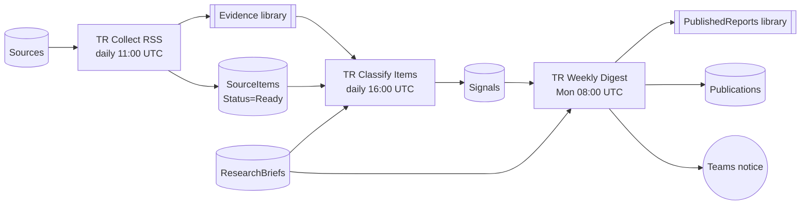

# Trend Research (Vigilante de Tendencias)

Monitors approved sources, classifies new items against research briefs with a bounded AI prompt, and publishes a weekly digest. Everything runs in the customer's tenant: Power Platform flows plus one SharePoint site.

| Path | Contents |
|---|---|
| `vertical.yaml` | solution unique name, version, locales, prompt versions |
| `solution/` | solution source (exported-zip layout with `{{tokens}}`) |
| `prompts/classify-signal.md` | classifier prompt (version 2) |
| `i18n/` | English / Spanish strings |
| `sharepoint/lists/` | list schemas: internal names, types, en/es display names, seed rows |
| `sharepoint/libraries.yaml` | Evidence, PublishedReports, ResearchDrafts |
| `sharepoint/reference-exports/` | the original SharePoint CSV exports (2026-11-02), for reference only |
| `docs/quickstart.{es,en}.md` | customer installation guide |
| `docs/design/` | design history and implementation guides |
| `docs/plans/` | implementation plans for the next workflows |

Build: `python3 tools/build.py trend-research` from the repo root. See [CHANGELOG](CHANGELOG.md).
