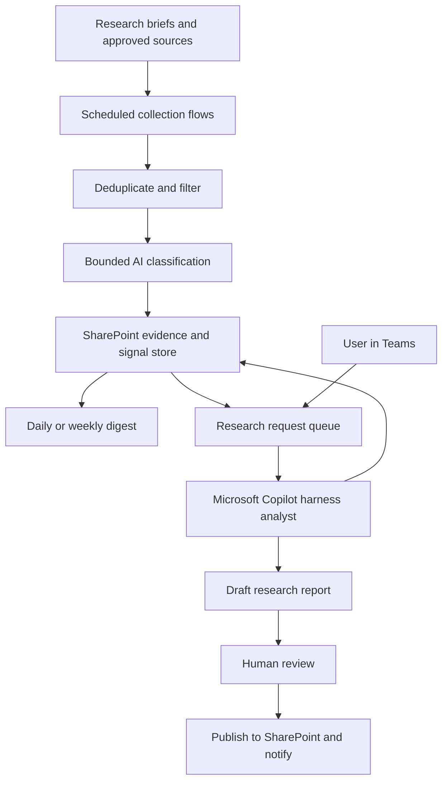

**I’d design this as a “Trend Researcher” accelerator with two operating modes: an inexpensive monitoring pipeline and a Copilot research analyst that handles selected deeper investigations.** Both run in the customer’s tenant and share the same evidence store.

One naming update: Microsoft announced on October 28 that the **GitHub Copilot harness is now called the Microsoft Copilot harness**. The rename does not change billing; documentation currently uses both names. [Microsoft announcement](https://www.microsoft.com/en-us/copilot/blog/copilot-studio/the-github-copilot-harness-in-copilot-studio-is-now-the-microsoft-copilot-harness/).

Below is the proposed design. Defaults are starting assumptions for a small internal deployment.

**1. Architecture and operating model**

| Approach | Advantage | Tradeoff |
|---|---|---|
| **Hybrid: scheduled flows + selective Copilot research — recommended** | Predictable monitoring costs with deeper analysis when useful | Two execution modes to configure |
| Copilot harness for everything | Flexible research behavior | More variable consumption; repeated reasoning for routine work |
| Power Automate and prompts only | Straightforward scheduled processing | Less capable at exploratory investigation |

The recommended architecture:

**Use standard-harness agent flows for unattended processing and the Microsoft Copilot harness for research tasks.** Standard agent flows support schedules, connectors, branching and AI actions, and can be packaged in solutions. [Agent-flow capabilities](https://learn.microsoft.com/en-us/microsoft-copilot-studio/flows-overview).

The two modes exchange persistent records and documents. The design does not depend on direct agent-to-agent delegation between harnesses.

**2. What the customer configures**

Everything starts with a **research brief**, rather than an industry-specific workflow.

| Setting | Example |
|---|---|
| Research question | “Which emerging technologies could change customer support?” |
| Topics and exclusions | Voice AI, automation; exclude consumer gadgets |
| Geography and language | LATAM; Spanish, Portuguese and English |
| Entities | Selected companies, technologies or institutions |
| Source scope | Approved feeds, APIs, sites and internal documents |
| Time horizon | Near term, medium term, long term |
| Collection frequency | Daily |
| Digest frequency | Weekly |
| Research intensity | Monitoring only, scheduled synthesis, on-demand investigation |
| Audience | Analysts, managers, selected Teams channel |
| Budget limits | Items processed and investigations permitted per period |
| Review policy | Digests automatic; detailed reports reviewed |

A research brief is versioned. Each analysis records which version it used, so changing the brief does not silently rewrite historical interpretation.

**3. Inexpensive monitoring pipeline**

Implement these as separate, restartable flows.

| Flow | Responsibility | Stored result |
|---|---|---|
| **Collect sources** | Fetch new RSS/API items or approved file submissions | Source items and collection checkpoints |
| **Normalize and deduplicate** | Standardize dates and URLs; identify previously processed items | Unique item record |
| **Filter and classify** | Apply rules, then a bounded AI prompt where needed | Structured signal |
| **Prepare digest** | Select relevant new signals and summarize them | Draft or published digest |
| **Queue research** | Create investigation requests from selected signals | Research job |
| **Publish and notify** | Deliver approved outputs once | Publication and delivery record |
| **Monitor operations** | Find failed collections, stale sources and stuck jobs | Operational exceptions |

Cost-saving behavior:

- Reject duplicates before calling AI.
- Apply topic, language and date rules first.
- Process each item once per relevant brief/content/prompt version.
- Use compact excerpts for initial classification.
- Retrieve full documents only when analysis requires them.
- Reuse stored findings across digests and reports.
- Cap each run’s item count and continue remaining work later.

RSS/API collection is the baseline. Arbitrary scraping, browser automation and difficult document extraction are separately scoped adapters.

**4. The classification contract**

The inexpensive AI step returns a fixed set of fields:

| Field | Meaning |
|---|---|
| Summary | Short factual description |
| Topics and entities | Approved taxonomy labels |
| Relevance score | Fit to the research brief |
| Signal type | Development, adoption, investment, regulation, research, other |
| Novelty | New development, update or repeated coverage |
| Potential impact | Low, medium or high, with explanation |
| Time horizon | Near, medium or long term |
| Supporting evidence | Source item IDs and supporting passages |
| Limitations | Missing details, uncertain interpretation or incomplete access |
| Suggested disposition | Ignore, monitor, include in digest or investigate |

Keep **relevance, evidence quality and potential impact separate**. A highly relevant claim can still have weak evidence.

Suggested initial routing:

- **Below 40 relevance:** retain metadata; exclude from digest.
- **40–69:** monitor.
- **70 or higher:** digest candidate.
- **Deep research:** selected by a reviewer or by an explicit rule combining relevance, impact and evidence.

These are configurable starting rules, not calibrated probabilities.

**5. The Copilot research analyst**

The Microsoft Copilot harness receives a **bounded research assignment**, not the entire archive.

Each assignment contains:

- Research question and brief version.
- Selected signal IDs.
- Evidence period and maximum evidence count.
- Permitted sources and tools.
- Requested output and language.
- Research limits and review requirements.

The harness is useful here because it supports reasoning across tools, knowledge and reusable skills. Microsoft documents workflow tools and Teams/Microsoft 365 channels for this experience. [Harness capabilities](https://learn.microsoft.com/en-us/microsoft-copilot-studio/agents-experience/overview).

Start with **one analyst agent and four reusable skills**:

| Skill | Behavior |
|---|---|
| **Investigate a signal** | Verify the development, find corroboration and explain uncertainty |
| **Synthesize a trend** | Group related developments, identify change over time and test alternative explanations |
| **Compare alternatives** | Compare technologies, approaches or organizations against explicit criteria |
| **Prepare a research brief** | Produce a cited report with implications and follow-up questions |

Avoid a large hierarchy of specialist agents initially. Add specialization only when evaluations demonstrate a benefit.

**6. Research tools and boundaries**

Give the analyst narrow tools with explicit inputs and outputs:

| Tool | Purpose |
|---|---|
| Get research brief | Read approved scope and configuration |
| List signals | Retrieve filtered, paginated signal records |
| Get evidence | Retrieve selected source content and provenance |
| Get prior reports | Establish historical context |
| Request approved-source retrieval | Ask a controlled collector to obtain additional material |
| Save research draft | Persist output and evidence references |
| Submit for review | Hand control back to the deterministic workflow |

The analyst should not directly change source policies, recipients, budgets or publication permissions.

For the first release, additional research uses approved sources. Broader web discovery can be an optional mode, with separate access, pricing and source-validation rules.

**7. Storage: SharePoint first**

For consultant-led deployment, start with **SharePoint Lists and document libraries**, rather than introducing SQL immediately.

| Store | Main contents |
|---|---|
| Research briefs | Scope, taxonomy, schedules, routing and review rules |
| Sources | Endpoint, source type, access classification, checkpoint and health |
| Source items | Unique key, URL, dates, document link and collection status |
| Signals | Brief ID, item ID, classification, scores and analysis version |
| Research jobs | Assignment, state, owner, limits and result link |
| Publications | Report version, approval and delivery status |
| Feedback | Reviewer corrections and usefulness ratings |
| Evidence library | Permitted snapshots, extracts and uploaded documents |
| Reports library | Digests, investigations and trend reports |

Use indexed fields and filtered queries. Keep large text and files in libraries.

Deduplication begins with source identifiers or normalized URLs. Where sources lack stable identifiers, introduce content fingerprints through an approved adapter. Do not rely on the model to prevent duplicates.

Move operational records to Dataverse or Azure SQL when concurrency, relationships, security or query performance justifies it. **The initial solution still requires the appropriate Power Platform environment and entitlements; SharePoint storage does not imply a Dataverse-free platform.**

**8. Research job lifecycle**

Use explicit persisted states:

`Queued → Claimed → Running → Draft ready → In review → Approved → Published`

Alternative states:

`Failed`, `Needs input`, `Rejected`, `Cancelled`

Required controls:

- Claim a job before execution and check its current version to prevent competing workers.
- Save outputs before moving the job to “Draft ready.”
- Validate required fields and evidence references.
- Reject incomplete output or send it for correction.
- Retry transient collection failures with bounded backoff.
- Queue failed items for operator attention after the retry limit.
- Track delivery using a unique publication/audience/version key.
- Resume from saved state after interruption.

A timeout after an email request can leave delivery uncertain. Record that condition for reconciliation rather than blindly resending.

**9. Outputs and user experience**

Use Teams as the research entry point, with SharePoint as the durable workspace.

Example requests:

- “What changed in my topics this week?”
- “Investigate signal 184.”
- “Compare these three approaches.”
- “What evidence contradicts this trend?”
- “Prepare a quarterly outlook using approved findings.”

| Output | Contents | Default publication rule |
|---|---|---|
| Signal digest | New developments, relevance and source links | Automatic within approved audience |
| Investigation | Verified facts, corroboration, gaps and implications | Analyst review |
| Trend report | Change over time, supporting signals, counterevidence and outlook | Analyst review |
| Comparison brief | Criteria, evidence, tradeoffs and uncertainties | Analyst review |

Every substantive report should distinguish **observed facts, interpretation and recommendations**. Citations must refer to retrieved evidence; missing evidence must be stated.

**10. Cost model and operating limits**

Keep three meters separate:

1. Workflow actions.
2. Bounded AI classification and summarization.
3. Copilot harness investigations.

The Copilot harness bills for model tokens, tools and runtime, and AI-assisted building/testing can also consume credits. Its costs should be measured through representative investigations, rather than estimated using standard-agent answer rates. [Harness billing](https://learn.microsoft.com/en-us/microsoft-copilot-studio/agents-experience/billing-credit-overview).

Illustrative pilot workload:

| Workload | Initial planning assumption |
|---|---:|
| Research briefs | 3 |
| Sources | 20 |
| New items per month | 2,000 |
| Items reaching AI classification | 500 |
| Weekly digests | 12 per month |
| Deep investigations | 8 per month |

If that workload executes **20,000 standard agent-flow actions**, the published rate of 13 credits per 100 actions gives **2,600 credits**. At a PAYG reference price of $0.01 per credit, that action component is **$26**. Classification, harness research, storage and licensing are additional. [Standard billing rates](https://learn.microsoft.com/en-us/microsoft-copilot-studio/requirements-messages-management), [credit purchase options](https://www.microsoft.com/licensing/guidance/Microsoft-Copilot-Studio).

Implement limits before starting work: daily classification allowance, research-job quota, maximum evidence returned and approval for larger investigations. Prompt instructions alone are not spending controls. Confirm which platform-enforced limits are available in the customer’s environment.

**11. Security and research quality**

- Separate public evidence from restricted internal context.
- Treat retrieved documents as evidence, never as instructions.
- Enforce allowed destinations and source permissions in tools.
- Restrict evidence returned to the requesting user’s authorized scope.
- Keep credentials in customer-controlled connections and approved secret stores.
- Disable optional conversational memory initially; use explicit project records for shared state.
- Record prompt, model/configuration and brief versions.
- Respect source access and retention rights; licensed content is not automatically approved for model processing.

**12. Deployment and handover**

Deliver a reusable package containing:

- Power Platform solutions for flows and agent components.
- Connection references and environment variables.
- SharePoint provisioning materials and configuration templates.
- Versioned prompt and skill definitions.
- Sample briefs and synthetic test evidence.
- Acceptance tests, operating guide and ownership matrix.
- Credit-sizing worksheet and source-adapter catalogue.

Customer deployment sequence:

1. Verify tenant features, region, licenses, billing and policies.
2. Create development/test and production environments.
3. Provision SharePoint structures.
4. Import solutions and bind customer connections.
5. Configure briefs, sources, roles and audiences.
6. Validate retrieval, scheduling, research invocation and publication.
7. Publish the Teams experience and enable schedules.
8. Train the customer administrator and research owner.

**Treat cross-harness invocation and complete export/import as deployment acceptance tests.** Start with user-triggered investigations if automated invocation is unavailable or unsuitable in the tenant. Microsoft documents solution transport, but some components and channel settings can require additional configuration after import. [Agent deployment limitations](https://learn.microsoft.com/microsoft-copilot-studio/authoring-solutions-import-export).

**13. Acceptance criteria**

Before handover, demonstrate that:

- Reprocessing the same source item creates no duplicate signal.
- Failed collection resumes without silently losing items.
- Unauthorized users cannot retrieve restricted evidence.
- Embedded instructions in source documents cannot trigger publication or configuration changes.
- Reports cite valid evidence and expose contradictions.
- Budget gates stop new work at the configured allowance.
- Publication requires the correct approval.
- A clean customer environment can be configured using the delivery package.
- Reviewed sample items meet customer-agreed relevance and factual-quality targets.

The consulting deliverable is the **configured research process, tenant package, source adapters, evaluation results and trained customer owners**. The baseline requires no custom Azure application, SQL server, bespoke dashboard or externally hosted service. Those become optional extensions when a demonstrated requirement warrants them.
