# TR Process Documents and TR Business Case: Implementation Plan

> **For agentic workers:** REQUIRED SUB-SKILL: Use superpowers:subagent-driven-development (recommended) or superpowers:executing-plans to implement this plan task-by-task. Steps use checkbox (`- [ ]`) syntax for tracking.

**Goal:** Add the document-upload ingestion adapter (`TR Process Documents`) and the business-case MVP (schema and classifier/digest changes, plus `TR Business Case`) to the Trend Research vertical as source code. Ship them as releases 1.2.0.0 and 1.3.0.0 in English and Spanish.

**Architecture:** Every change lands in `verticals/trend-research/` source: list YAML, flow JSON with `{{tokens}}`, prompts, i18n. It ships through `tools/build.py`, whose validator is extended to the new lists, libraries and triggers. Flows are tested statically: Python tests assert the structure of the rendered JSON. Behavior in a tenant is covered by an acceptance checklist per release. In 1.2.0.0, uploads are plain-text public documents only, with no redaction. Binary formats, private documents and redaction wait for a Dataverse or Azure Function add-on (see Open decisions).

**Tech Stack:** Power Automate / Copilot Studio agent flow JSON (Workflow Definition Language), SharePoint Online connector, Approvals, Teams, Copilot Studio agent node (`shared_agentnode`), Python 3.12 + PyYAML (`unittest`).

**Spec:**
- `verticals/trend-research/docs/design/tr-process-documents-design.md`: Part A.
- `verticals/trend-research/docs/design/2026-11-02-tr-business-case-design.md`: Part B.
- `docs/architecture.md`: portability rules every task must follow.

The two parts are independent. Part A can ship without Part B and vice versa; Part 0 is needed by both.

## Global Constraints

- Follow `docs/architecture.md#portability-rules`: no tenant literals in flows, internal names are contracts, stored status values are English codes, library URL names are English, prompts are versioned.
- New SharePoint columns use descriptive English internal names (`SourcePath`, `Product`). **Never rename** existing `field_N` columns.
- Choice columns store English codes in every locale. The display name is localized; the choice values are not.
- Every new flow and environment variable needs `en` and `es` strings. `test_every_en_key_exists_in_es` must stay green.
- Every new flow is a new `Workflows/<Name>-<GUID>.json` plus a `<Workflow>` entry in `customizations.xml` (Category 5, ModernFlowType 1, the same attributes as the existing three), with `metadata.associatedData` absent.
- "Do not use filename alone" for dedupe. `ItemKey` = `<Source ID>|<the file's list item ID>`. The ID survives renames; `{Identifier}` is path-based and doesn't.
- 1.2.0.0 reads only files under `/SourceUploads/PublicData/`. Private documents are out of scope until a redaction add-on exists, and the flow must not read them even if a Sources row points at them.
- Flow JSON follows the `shared/flow-snippets/README.md` rules. The Task 0.2 validator enforces most of them.
- Business-case publication key: `businesscase|<RequestID>|v<Version>`. `InputPublicationIds` must hold 1–5 IDs.
- Missing financial inputs are reported as `Unknown`. ROI is never calculated without supplied values.
- Bump `vertical.yaml: solution.version` (1.2.0.0 for Part A, 1.3.0.0 for Part B) and every changed prompt's version.

## Review Focus

1. **A Sources row pointing at a private folder** (`/SourceUploads/PrivateData/HR`) must not make the flow read that folder. Tested in Task A2 (`test_only_public_paths_are_read`).
2. **A PDF, Word file or oversized text file** must give `ContentStatus=MetadataOnly`, never `FullText` with garbled content. Tested in Task A2 (`test_unsupported_type_is_metadata_only`, `test_text_gate_case_insensitive_and_sized`).
3. **Re-uploading, editing or renaming the same file** must not create a second SourceItem. The trigger fires on modifications too, and the ItemKey uses the file's list item ID. Tested in Task A2 (`test_dedupe_uses_item_id`).
4. **A file dropped outside any configured source folder**, e.g. directly in `PublicData/`, must stop cleanly without an Evidence file. Tested in Task A2 (`test_unmatched_folder_stops_before_evidence`).
5. **A model response with a tag outside the allowed list** must not be written as-is. Tested in Task B2 (`test_alert_tags_filtered_to_allowed`).

---

## Target flows

```mermaid
flowchart TD
    subgraph A["Part A: TR Process Documents (1.2.0.0)"]
        U[File created or modified in SourceUploads] --> M[Get file metadata]
        M --> PUB0{Under /SourceUploads/PublicData/?}
        PUB0 -- no --> X0[stop]
        PUB0 -- yes --> SRC{Source with SourcePath = parent folder?}
        SRC -- no --> X1[stop]
        SRC -- yes --> K["ItemKey = SourceID | file item ID"]
        K --> DUP{SourceItem exists?}
        DUP -- yes --> X2[stop]
        DUP -- no --> TXT{"txt, md, csv, html, htm<br/>and size within the limit?"}
        TXT -- yes --> GC[Get content as UTF-8 text]
        TXT -- no --> MO[MetadataOnly]
        GC --> EV[Create Evidence/upload-ID.txt]
        MO --> EV
        EV --> SI[Create SourceItem Status=Ready]
        SI --> CL[existing TR Classify Items]
    end
    subgraph B["Part B: TR Business Case (1.3.0.0)"]
        R["BusinessCaseRequests item modified,<br/>trigger condition Status = Submitted"] --> V[Validate request + claim with ETag]
        V --> D[Parse + validate 1-5 digest Publications]
        D --> G[Agent node: structured case, validate citations]
        G --> DR[ResearchDrafts HTML + Publication ReviewStatus=Draft]
        DR --> AP[Approval]
        AP -- approved --> PUB[Copy to PublishedReports, notify]
        AP -- rejected or timeout --> REJ[Rejected, stays restricted]
    end
```

## File map

| Path | Responsibility | Tasks |
|---|---|---|
| `tools/build.py` | Choice/MultiChoice fields, `since` upgrade notes, flow lint rules, `{{library:}}` token, library folders | 0.1, 0.2, A1 |
| `tools/tests/test_build.py` | build-level tests | 0.1, 0.2, A1 |
| `tools/tests/test_trend_research_flows.py` (new) | static structure tests for TR flows | A2, B2–B6 |
| `tools/tests/flowtest.py` (new) | helpers: `find_action(doc, name)`, `run_after(doc, name)`, `params(doc, name)`, `path_to(doc, name)` | A2 |
| `shared/flow-snippets/{sharepoint,approvals,teams}/*.json`, `README.md` (new) | sanitized connector shapes from real exports, plus the authoring rules learned from them | 0.2 |
| `verticals/trend-research/solution/Workflows/TR{CollectRSS,ClassifyItems,WeeklyDigest}-*.json` | designer newline and loop-concurrency fixes | 0.3 |
| `verticals/trend-research/sharepoint/lists/*.yaml` | schema changes, new `07-BusinessCaseRequests.yaml` | A1, B1 |
| `verticals/trend-research/sharepoint/libraries.yaml` | `SourceUploads` (with the `PublicData` folder) | A1 |
| `verticals/trend-research/docs/design/adr-001-text-only-uploads.md` (new) | text-only public uploads, no redaction, add-on seams | A3 |
| `verticals/trend-research/solution/Workflows/TRProcessDocuments-58BCA39F-6F0F-4947-BA05-D2291EA1E08D.json` (new) | Part A flow | A2 |
| `verticals/trend-research/solution/Workflows/TRBusinessCase-9373450F-FA1E-44C2-ACE2-2D86CA9249C7.json` (new) | Part B flow | B4–B6 |
| `verticals/trend-research/prompts/classify-signal.md` | v3: product, dimension, alert tags, objectives | B2 |
| `verticals/trend-research/prompts/business-case.md` (new) | business-case generation prompt | B5 |
| `verticals/trend-research/i18n/{en,es}.yaml`, `customizations.xml`, `environmentvariabledefinitions/` | names, env vars, connection refs | each flow task |
| `verticals/trend-research/docs/quickstart.{es,en}.md`, `CHANGELOG.md` | customer docs per release | A3, B7 |

---

## Part 0: Foundation

### Task 0.1: Choice fields and upgrade notes in the build

Customers on the PnP path get new columns by re-running `pnp/provision.ps1` from the new kit; the template and `expected-schema.json` pick up new YAML fields automatically. Customers on the CSV path add new columns by hand, so the kit must tell them exactly which columns to add, and the internal name must be typed first and renamed afterwards (SharePoint sets the internal name from the first name typed). New field types must also be supported by `render_pnp_template` and pass the PnP XSD test.

**Files:**
- Modify: `tools/build.py` (`field_xml`, `render_sharepoint_kit`)
- Test: `tools/tests/test_build.py`

**Interfaces:**
- Produces, for list YAML:
  - a field may carry `since: "<version>"`;
  - `type: Choice | MultiChoice` with `choices: [codes]`;
  - `required: true`;
  - `default: <value>`;
  - `indexed: true`.
- Produces `render_upgrade_notes(vertical, locale) -> bytes`. The kit gets `upgrade-<version>.<locale>.md` listing every field and list whose `since` equals the current version: list title, internal name, type, choices, localized display name. The kit gets nothing when there are no such fields.
- The `since` attribute on a whole list (top-level `since:`) means "new list: create from CSV".

- [ ] **Step 1: Write the failing tests** in `SharePointKitTests`:
  - `test_multichoice_field_xml`: a field `{name: AlertTags, type: MultiChoice, choices: [CompetitorLaunch, RegulatoryAlert, NewTechnology]}` renders `Type="MultiChoice"` with three `<CHOICE>` elements in that order.
  - `test_required_and_default`: `required: true` → `Required="TRUE"`. `default: Draft` on a Choice → `<Default>Draft</Default>`.
  - `test_upgrade_notes_list_new_fields`: with a temporary list YAML holding one field with `since` equal to the vertical's version, the es notes contain the internal name, the type code (`Choice`) and the Spanish display name. With no `since` fields, the kit has no `upgrade-*` entry.
- [ ] **Step 2:** Run `python3 -m unittest discover -s tools/tests`. Expected: the 3 new tests FAIL.
- [ ] **Step 3:** Implement the field types and `render_upgrade_notes`. Localized labels for the notes' fixed text (column headings, the "type the internal name first, then rename" instruction) go in `shared/i18n/{en,es}.yaml` under `upgrade.*`.
- [ ] **Step 4:** Run the tests. Expected: all PASS, and the existing 34 still PASS.
- [ ] **Step 5:** Commit: `git commit -m "build: choice fields and per-release SharePoint upgrade notes"`

### Task 0.2: Snippet library and validator rules

New flows copy connector shapes from real exports, not from guesses. No manual capture round is needed. Every operation Part A uses comes from Boss's test export `TR Doc Test` (`brainstorm/tr-exported-solution/Workflows/Workflows/TRDocTest-BBEB07A1-….json`, git-ignored). Most Part B operations come from flows Microsoft and PnP publish. Only `CopyFileAsync` is built from the connector reference alone, so it stays marked unverified until the 1.3.0.0 acceptance run.

**Files:**
- Create: `shared/flow-snippets/README.md` and one JSON file per operation (below).
- Modify: `tools/build.py` (`validate_solution`)
- Test: `tools/tests/test_build.py`

**Interfaces:**
- Produces snippet files. Each has the shape `{ "connector", "operationId", "source": "tenant-export" | "coe-starter-kit" | "pnp-samples" | "connector-docs", "verified": bool, "notes": [..], "trigger" | "action": {...} }`. Every tenant value is replaced:
  - `dataset` → `@parameters('Site URL (tr_SiteURL)')`
  - `table` → `<list-or-library-parameter>`
  - `connectionName` → the connector's short name (`shared_sharepointonline`), as in the existing flows
  - `metadata.nodeId` is dropped.

| File | Operation | Source |
|---|---|---|
| `sharepoint/trigger-file-created-or-modified.json` | `GetOnUpdatedFileItems` | tenant export |
| `sharepoint/trigger-item-created-or-modified.json` | `GetOnUpdatedItems` + `conditions` | PnP samples |
| `sharepoint/get-file-metadata.json` | `GetFileMetadata` | tenant export |
| `sharepoint/get-file-content.json` | `GetFileContent` | tenant export |
| `sharepoint/create-file.json` | `CreateFile` | tenant export |
| `sharepoint/send-http-request.json` | `HttpRequest` | CoE Starter Kit |
| `sharepoint/copy-file.json` | `CopyFileAsync` | connector docs, `verified: false` |
| `approvals/start-and-wait.json` | `StartAndWaitForAnApproval` | CoE Starter Kit |
| `teams/post-message.json` | `PostMessageToConversation` | CoE Starter Kit |

- The README records the lessons from the tenant export:
  - The trigger's `{Identifier}` feeds the `id` of `GetFileMetadata` and `GetFileContent`. The trigger's `ID` is the file's list item ID, and it survives renames.
  - **`GetFileContent` with `inferContentType: false`.** The body is then always `{"$content-type", "$content"}`, and `base64ToString(body(..)?['$content'])` is safe. The export used `true`, which can return text files as a plain string. The 1.2.0.0 acceptance run confirms the choice.
  - **Extension checks use `toLower`.** `endsWith(name, '.txt')` misses `REPORT.TXT`.
  - **The designer adds a trailing `\n`** when Enter is pressed in a field. The export's `Create_file.name` ended in `\n`, and so do two 1.1.0.0 values (see Task 0.3).
  - **`SetVariable` cannot reference its own variable.** Inside a loop, use `Compose` and then `Set variable` from the Compose output.
  - **A loop that sets a variable must run sequentially:** `runtimeConfiguration.concurrency.repetitions: 1`.
  - **"For a selected item" is not used.** That trigger only appears in SharePoint's Automate menu for flows in the default environment. Use "When an item is created or modified" with a trigger condition instead.
- Produces validator rules. Each raises `BuildError` naming the flow and the action:
  1. A trigger with `dataset`/`table` must use `@parameters(...)`.
  2. A `folderPath`/`path` that starts with `/` must start with a library `urlName` from `libraries.yaml`.
  3. **Loop guard.** A file trigger's library (the env var whose default is `{{library:X}}`) must not be a library the same flow writes with `CreateFile` or `CopyFileAsync`. Otherwise each write fires the trigger again.
  4. A `SetVariable` value must not contain `variables('<its own name>')`.
  5. A `Foreach` whose actions (at any depth) set, append to or increment a variable must have `concurrency.repetitions == 1`.
  6. A string value with exactly one line break, at its end, is rejected as a designer artifact. Multi-line HTML and notes have more than one line break, so they pass.
  7. The existing `item/<field>` and `$filter` checks also apply to `PatchItem`. They cover new lists automatically once their env var default uses `{{list:Key}}`.
  8. A `connectionReferences` entry must not carry `connectionName`: that is a connection instance in the exporting tenant. This rule is already in place (added 2026-11-02, `test_tenant_connection_name_fails`).

- [ ] **Step 1:** Write the snippet files and the README from the sources above. Copy only the trigger or action block. Replace tenant values as listed.
- [ ] **Step 2: Write the failing tests:**
  - `test_trigger_with_literal_site_fails`: set the Classify trigger's `dataset` to `"https://x"` → `BuildError` matching `trigger`.
  - `test_unknown_library_path_fails`: set `Save_RSS_Evidence.folderPath` to `/Nope` → error matching `/Nope`.
  - `test_trigger_library_written_by_same_flow_fails`: use a fixture flow whose trigger reads `{{library:Evidence}}` and that runs `CreateFile` to `/Evidence`.
  - `test_set_variable_self_reference_fails`
  - `test_parallel_loop_setting_variable_fails`: remove the `runtimeConfiguration` from Collect's `Apply_to_each` → error matching `Apply_to_each`.
  - `test_trailing_newline_fails`: append `\n` to a `$filter` → error.
  - `test_snippets_are_tenant_free`: no snippet contains `sharepoint.com`, a GUID-shaped `table`, or a 32-hex `connectionName`.
- [ ] **Step 3:** Run the tests. Expected: they FAIL. After Task 0.3 lands, the 1.1.0.0 flows also fail rules 5 and 6.
- [ ] **Step 4:** Implement the rules in `validate_solution`.
- [ ] **Step 5:** Run all tests. Expected: PASS once Task 0.3 is in.
- [ ] **Step 6:** Commit: `git commit -m "build: connector snippet library and flow lint rules"`

### Task 0.3: Fix the 1.1.0.0 flows the new rules catch

Both problems come from the designer and are in the flows as built in the UI.

- **Trailing newlines.**
  - `TRCollectRSS` → `Build_ItemKey` writes the ItemKey as `<SourceID>|<entry id>\n`.
  - `TRWeeklyDigest` → `Get_Existing_Publication` has `$filter: "… eq '…'\n"`.
- **Variables set inside parallel loops.** None of these loops sets a concurrency limit. If the engine runs their iterations in parallel, two iterations overwrite each other's `ItemKey` or `AnalysisKey`.
  - `TRCollectRSS` → `Apply_to_each` (`ItemKey`)
  - `TRClassifyItems` → `Loop_2` (`AnalysisKey`)
  - `TRWeeklyDigest` → `Loop_Brief` and `Loop`

**Files:** the three flow JSONs, `CHANGELOG.md` (1.2.0.0 "Fixes"), tests.

- [ ] **Step 1 (manual, dev tenant, before coding):** Open one existing SourceItem and check whether its ItemKey (`field_3`) ends with a line break. Copy the value into a text editor to see it. The answer decides the upgrade note:
  - **If it does,** the first Collect run after upgrading re-creates the items that are still in the feeds, once. The CHANGELOG says so.
  - **If it doesn't,** SharePoint strips the line break on save. Then the 1.1 dedupe filter never matched, and every Collect run has been creating duplicates. The CHANGELOG says that instead, with a cleanup note.
- [ ] **Step 2:** Remove the two trailing `\n`. Add `"runtimeConfiguration": {"concurrency": {"repetitions": 1}}` to the four loops.
- [ ] **Step 3:** Run all tests. Expected: PASS, including the Task 0.2 rules.
- [ ] **Step 4:** Commit: `git commit -m "trend-research: remove designer newlines, run variable loops sequentially"`

---

## Part A: TR Process Documents (release 1.2.0.0)

**Scope, decided by Boss (2026-11-02):**
- **Text files only.** `.txt`, `.md`, `.csv` and `.html` are read as UTF-8 text. `.htm` is accepted too (my call: same format). Every other type gets a `MetadataOnly` SourceItem: the classifier sees the file name and folder, not the content.
- **No data filtering.** Case-insensitive replacement and regex need Dataverse actions or an Azure Function, not flow expressions. Redaction is out of scope until that add-on exists (see Open decisions).
- **No private documents in 1.2.0.0.** Without redaction, the design's `PrivateData` rule ("only the redacted derivative reaches Evidence") can't hold. The flow reads files only under `/SourceUploads/PublicData/`. A `PrivateData` folder, or a Sources row pointing at one, is ignored. Public sources keep the design's `PublicData/<source>` layout, so source paths don't change when private uploads arrive later.

### Task A1: Schema, library token and folders

**Files:**
- Modify:
  - `tools/build.py`: `{{library:Key}}` token; library `folders` in the PnP template and in `expected-schema.json`
  - `sharepoint/lists/02-Sources.yaml`, `sharepoint/libraries.yaml`
  - `i18n/{en,es}.yaml` (`env.*`)
  - `vertical.yaml`: version `1.2.0.0`
- Create: environment variable definitions `tr_SourceUploadsLibrary`, `tr_MaxUploadBytes`
- Test: `tools/tests/test_build.py`

**Interfaces:**
- Produces the token `{{library:Key}}`, which resolves to the library's localized title (`libraries.yaml` `title.<locale>`). The validator maps an env var whose default is `{{library:X}}` to library `X`; Task 0.2's loop-guard rule uses this mapping.
- Produces `folders: [..]` on a library. The PnP template renders `<pnp:Folders>`. `provision.ps1` checks that each folder exists. The quickstart tells CSV-path users to create the folders by hand. Folder names are never localized.
- Produces the field `Sources.SourcePath` (Text, indexed, `since: "1.2.0.0"`). Example: `/SourceUploads/PublicData/VendorDocuments`, which is the library URL name plus the folder path, with no trailing slash.
- Produces the library `SourceUploads` (es title `Cargas de fuentes`), with `folders: [PublicData]`.
- Produces environment variables:
  - `tr_SourceUploadsLibrary`: default `{{library:SourceUploads}}`. If the trigger rejects a title, the customer puts the library GUID here (A3 acceptance checks which).
  - `tr_MaxUploadBytes`: Number, default `1000000` (my call). Larger files become `MetadataOnly`, which keeps runs cheap and predictable.
- `Sources.SourceType` gets no new column. The value `Upload` already exists per design.

- [ ] **Step 1: Write the failing tests:**
  - `test_library_token_resolves_localized_title`: es renders `Cargas de fuentes`, en renders `Source Uploads`.
  - `test_library_folders_in_pnp_template`: the template has `PublicData` under `SourceUploads` and still validates against the XSD.
  - `test_provision_reports_missing_folder`: against the mock site without `PublicData`, the script exits 1 and names the folder. Extend `pnp_mock` with `Get-PnPFolder`.
  - `test_upgrade_notes_1_2`: the es notes list `SourcePath` and the library `SourceUploads` with its folder.
- [ ] **Step 2:** Run the tests. Expected: FAIL.
- [ ] **Step 3:** Implement the token and folders in the build. Add the YAML, the env var definitions and the i18n keys.
- [ ] **Step 4:** Run the tests. Expected: PASS.
- [ ] **Step 5:** Commit: `git commit -m "trend-research: schema for document uploads"`

### Task A2: Flow TR Process Documents

**Files:**
- Create:
  - `solution/Workflows/TRProcessDocuments-58BCA39F-6F0F-4947-BA05-D2291EA1E08D.json`
  - `tools/tests/flowtest.py`
  - `tools/tests/test_trend_research_flows.py`
- Modify:
  - `solution/customizations.xml`: add `<Workflow WorkflowId="{58bca39f-6f0f-4947-ba05-d2291ea1e08d}" Name="{{t:flows.processDocuments.name}}">`. It reuses the existing SharePoint connection reference; no new connector.
  - `i18n/{en,es}.yaml`: en `TR Process Documents`, es `VT Procesar Documentos`, plus descriptions.

**Interfaces:**
- Consumes the Task 0.2 snippets and the Task A1 field and env vars.
- Produces these action names. The tests rely on them.

| # | Action | Operation | Key inputs |
|---|---|---|---|
| T | `When_a_file_is_created_or_modified` | `GetOnUpdatedFileItems` | site `tr_SiteURL`, table `tr_SourceUploadsLibrary`, recurrence 5 min, `splitOn`, trigger concurrency `runs: 1` |
| 1 | `Get_Upload_Metadata` | `GetFileMetadata` | `id` = trigger `{Identifier}` |
| 2 | `Build_Source_Path` | Compose | metadata `Path` up to its last `/`, e.g. `/SourceUploads/PublicData/VendorDocuments` |
| 3 | `If_Public_Path` | If `startsWith(<2>, '/SourceUploads/PublicData/')` | else: nothing. Nothing outside PublicData is ever read. |
| 4 | `Get_Upload_Source` | GetItems on `tr_SourcesList` | `$filter`: `field_2 eq 'Upload' and field_3 eq 1 and SourcePath eq '<2 with ' doubled>'`, `$top` 1 |
| 5 | `If_Source_Found` | If `length(value) > 0` | else: nothing |
| 6 | `Build_ItemKey` | Compose | `<Source ID>|<trigger ID>`, where the trigger ID is the file's list item ID |
| 7 | `Check_Upload_SourceItem_Exists` | GetItems on `tr_SourceItemsList` | `$filter`: `field_3 eq '<6>'`, `$top` 1 |
| 8 | `If_New_Upload` | If `empty(value)` | else: nothing. Edits and renames of an already-processed file stop here. |
| 9 | `If_Text_File` | If the extension is in `txt md csv html htm` (via `toLower(last(split(Name,'.')))`) **and** `Size <= tr_MaxUploadBytes` | yes: `Get_Upload_Content` (`inferContentType: false`), then `Set_Text` = `base64ToString(..['$content'])`. no: `Set_ContentStatus_MetadataOnly`. |
| 10 | `Compose_Normalized_Text` | Compose | the design's header block: `SOURCE FILE:`, `SOURCE:`, `SOURCE TYPE: Upload`, `PRIVACY: Public`, `COLLECTED:` utcNow, `CONTENT:` Text |
| 11 | `Create_Upload_Evidence` | CreateFile | folderPath `/Evidence`, name `upload-@{trigger ID}.txt` (the original name is never used, because it could collide), body <10> |
| 12 | `Create_Upload_SourceItem` | PostItem on `tr_SourceItemsList` | see below |

Variables:
- `Text` (String)
- `ContentStatus` (String, initialized `FullText`)

`Create_Upload_SourceItem` field mapping:
- `Title` = file name
- `field_1` = source ID
- `field_2` = trigger ID
- `field_3` = ItemKey
- `field_4` = link to the original file
- `field_7` = Evidence `Path`
- `field_8` = `ContentStatus`
- `field_9` = `Ready`
- `CollectedAt` = `utcNow()`
- `PublishedAt` is left blank

- [ ] **Step 1: Write `flowtest.py`** with these helpers:
  - `load_built(locale, filename) -> dict`, via `build.render_solution`
  - `find_action(doc, name) -> dict`, recursive; raises `KeyError`
  - `params(doc, name) -> dict`
  - `run_after(doc, name) -> dict`
  - `path_to(doc, name) -> list[str]`: the names of the enclosing actions, with `/else` or `/case:<x>` suffixes for branches
- [ ] **Step 2: Write the failing tests** in `test_trend_research_flows.py`:
  - `test_trigger_uses_env_vars`: dataset is `@parameters('Site URL (tr_SiteURL)')`, table is `@parameters('Source Uploads library (tr_SourceUploadsLibrary)')`, operation is `GetOnUpdatedFileItems`.
  - `test_trigger_single_concurrency`
  - `test_only_public_paths_are_read`: `path_to(Get_Upload_Source)` and `path_to(Get_Upload_Content)` both start with `If_Public_Path`, and its expression checks `'/SourceUploads/PublicData/'`.
  - `test_unmatched_folder_stops_before_evidence`: `path_to(Create_Upload_Evidence)` contains `If_Source_Found` and `If_New_Upload`.
  - `test_source_path_filter_escapes_quotes`: the `$filter` doubles single quotes in `<2>`, so a folder named `Client's` doesn't break the query.
  - `test_dedupe_uses_item_id`: `Build_ItemKey` uses the trigger's `ID`, not `{Name}` or `{FilenameWithExtension}`. `Get_Upload_Content` is inside `If_New_Upload`.
  - `test_text_gate_case_insensitive_and_sized`: `If_Text_File` uses `toLower`, lists exactly the five extensions and references `tr_MaxUploadBytes`.
  - `test_unsupported_type_is_metadata_only`: the else branch of `If_Text_File` sets `ContentStatus` to `MetadataOnly`, and `item/field_8` reads that variable.
  - `test_get_content_not_inferred`: `inferContentType` is `false`.
  - `test_evidence_name_uses_item_id`
  - `test_source_item_ready`: `item/field_9 == "Ready"`.
  - `test_process_documents_localized`: the es customizations contain `Name="VT Procesar Documentos"`.
- [ ] **Step 3:** Run `python3 -m unittest discover -s tools/tests`. Expected: the new tests FAIL.
- [ ] **Step 4:** Write the flow JSON from the snippets and the table.
- [ ] **Step 5:** Run all tests and `python3 tools/build.py trend-research`. Expected: PASS, with no validator errors.
- [ ] **Step 6:** Commit: `git commit -m "trend-research: TR Process Documents flow"`

### Task A3: ADR, docs and release 1.2.0.0

**Files:**
- Create: `docs/design/adr-001-text-only-uploads.md`
- Modify: `docs/quickstart.{es,en}.md`, `CHANGELOG.md`
- Release: `releases/trend-research/1.2.0.0/`

- [ ] **Step 1:** Write ADR-001:
  - **Context:** the design asked for extraction "by the actions actually exposed by your tenant" and for redaction of private documents. Boss's test flow showed that flow expressions can only replace exact-case keywords, one per action.
  - **Decision:** the Part A scope above, plus the size cap.
  - **Consequences:**
    - PDF, Office and other binary files are metadata-only.
    - HTML is kept raw, tags included.
    - Private documents need the add-on.
  - **Add-on:** the redaction and conversion options in Open decisions. It plugs in at the else branch of `If_Text_File`, and as a new private branch beside `If_Public_Path`.
- [ ] **Step 2:** Update both quickstarts:
  - Create `SourceUploads` with `PublicData`. The CSV path does this by hand; PnP does it automatically.
  - Add one Sources row per upload subfolder: `SourceType=Upload`, `SourcePath`, `Enabled=1`.
  - Explain which file types are read, the size limit, and that private documents must not be uploaded.
  - Add an "upgrading from 1.1" section that points to `upgrade-1.2.0.0.<locale>.md`.
- [ ] **Step 3:** Add a CHANGELOG entry, including the Task 0.3 fixes and the upgrade effect found in its Step 1. Run `python3 tools/build.py trend-research --release`. Expected: `releases/trend-research/1.2.0.0/` holds 4 zips and `SHA256SUMS`.
- [ ] **Step 4 (manual, dev tenant): acceptance.**
  - The trigger accepts the library **title** from `tr_SourceUploadsLibrary`, in an es environment too. If it doesn't, switch the default to "paste the library ID" and update the quickstart.
  - A `.txt` file containing `á ñ ü`, put in `PublicData/VendorDocuments`, gives Evidence with the accents intact and a Ready SourceItem. This confirms `inferContentType: false` and UTF-8.
  - `NOTES.TXT`, with an uppercase extension, is processed.
  - Uploading the same file again, editing it or renaming it creates no new SourceItem.
  - A `.pdf` file, and a text file larger than `tr_MaxUploadBytes`, each give `MetadataOnly`.
  - These cause no reads and no writes:
    - a file in the `PublicData/` root (no matching source);
    - a file in a hand-made `PrivateData/X` folder that has a matching Sources row.
  - Writing to Evidence doesn't trigger the flow again.
  - The next `TR Classify Items` run classifies the new items.
- [ ] **Step 5:** Commit: `git commit -m "release: trend-research 1.2.0.0"`

---

## Part B: Business-case MVP (release 1.3.0.0)

### Task B1: Schema for products, dimensions, tags and business cases

**Files:**
- Modify: `sharepoint/lists/01-ResearchBriefs.yaml`, `04-Signals.yaml`, `05-Publications.yaml`
- Create: `sharepoint/lists/07-BusinessCaseRequests.yaml`, env var `tr_BusinessCaseRequestsList`, library `ResearchDrafts` (already declared; add the `restricted: true` note to the quickstart)
- Test: `tools/tests/test_build.py`

**Interfaces.** All new fields are `since: "1.3.0.0"`; internal names are exactly as written.

- **ResearchBriefs:**
  - `Product` (Text, required)
  - `Dimension` (Choice, required): the four dimension codes. Decided by the customer, see Open decisions; until then `Market`, `Technology`, `Regulatory`, `Competition`.
  - `BriefType` (Choice: `Monitoring`, `Investigation`; default `Monitoring`)
- **Signals:**
  - `AlertTags` (MultiChoice: `CompetitorLaunch`, `RegulatoryAlert`, `NewTechnology`)
  - `Objectives` (MultiChoice: `Anticipate`, `MinimizeRisks`, `Compare`, `Innovate`, `Cooperate`)
- **Publications:**
  - `BriefId` (Number)
  - `Product` (Text)
  - `Dimension` (Text snapshot; `Multiple` allowed)
  - `PublicationType` (Choice: `Digest`, `BusinessCase`)
  - `BusinessCaseRequestId` (Number)
  - `InputPublicationIds` (Text)
  - `ReviewStatus` (Choice: `Draft`, `InReview`, `Approved`, `Rejected`)
  - `Version` (Number)
- **BusinessCaseRequests** (es `SolicitudesCasoNegocio`): every column in the spec's table, with the exact internal names given there:
  - `Title`, `Product`, `DecisionQuestion`, `Geographies`, `TimeHorizon`, `Alternatives`, `StrategicObjectives`, `FinancialInputs`, `Constraints`, `InputPublicationIds`, `ReviewerEmail`, `AudienceKey`, `PreviousRequestId`
  - `Version` (default 1)
  - `Status` (Choice: `Draft`, `Submitted`, `Generating`, `InReview`, `Approved`, `Rejected`, `Failed`; default `Draft`)
  - `PublicationId`, `LastError`
- Each Spanish display name comes from the spec's "Spanish display names" requirement. Write the labels in `es`; the choice codes stay English.

- [ ] **Step 1: Write the failing tests:**
  - `test_business_case_requests_schema`: the es CSV has all 17 internal names and the `Status` choices in the order above.
  - `test_upgrade_notes_1_3`: the notes list all new fields of the three existing lists.
- [ ] **Step 2:** Run the tests. Expected: FAIL.
- [ ] **Step 3:** Implement the YAML, the env var and the i18n. Set the version to `1.3.0.0`.
- [ ] **Step 4:** Run the tests. Expected: PASS.
- [ ] **Step 5:** Commit: `git commit -m "trend-research: business-case MVP schema"`

### Task B2: Classifier v3 (product, dimension, tags, objectives)

**Files:** `prompts/classify-signal.md`, `vertical.yaml` (prompt version → 3), `solution/Workflows/TRClassifyItems-*.json`, `tools/tests/test_trend_research_flows.py`

**Interfaces:**
- The prompt's RESEARCH BRIEF section adds `Product: @{items('Loop_2')?['Product']}` and `Dimension: @{items('Loop_2')?['Dimension']}`.
- The structured output schema in `Classify_TR_Signal.inputs.parameters['body/definition'].entity.configuration.agentSettings.output.schema` adds two array-of-string properties, `AlertTags` and `Objectives`, both required. The prompt lists the allowed codes and says a tag needs brief context plus evidence, not just a topic mention.
- New action `Filter_AlertTags` (Query action, `from` the model output, `where` `contains(createArray('CompetitorLaunch','RegulatoryAlert','NewTechnology'), item())`) and `Filter_Objectives` (the same, with the 5 objective codes) run before `Create_Signal`.
- `Create_Signal` writes `item/AlertTags` and `item/Objectives` from the filtered arrays. If `length(raw) != length(filtered)`, it sets `item/field_11 = 'NeedsReview'` and appends `Invalid tags: <raw>` to `field_10`.
- `Mark_SourceItem_Classified` runs after `Loop_2` with `runAfter: ["Succeeded","Failed"]`. It writes `Classified` only when no iteration failed, and `Failed` with `field_10`-style notes on the SourceItem otherwise. The spec says "not marked fully classified until all intended enabled briefs are processed or their failures are recorded".

- [ ] **Step 1: Write the failing tests:**
  - `test_prompt_v3_has_product_dimension`
  - `test_alert_tags_filtered_to_allowed`: `Create_Signal` reads `body('Filter_AlertTags')`, and the filter's `where` lists exactly the three codes.
  - `test_invalid_tags_route_to_review`: the `field_11` expression contains `NeedsReview`.
  - `test_analysis_key_uses_prompt_v3`: the key ends with `|3`.
  - `test_failed_brief_not_marked_classified`.
- [ ] **Step 2:** Run the tests. Expected: FAIL.
- [ ] **Step 3:** Implement. Add `NeedsReview` to the Signals status values documented in `docs/architecture.md`.
- [ ] **Step 4:** Run the tests and the build. Expected: PASS.
- [ ] **Step 5:** Commit: `git commit -m "trend-research: classifier v3 with alert tags and objectives"`

### Task B3: Weekly digest by product, dimension and objective

**Files:** `solution/Workflows/TRWeeklyDigest-*.json`, `i18n/{en,es}.yaml` (`digest.product`, `digest.dimension`, `digest.question`, `digest.noFindings`, `digest.alertTags`, `codes.objective.*`, `codes.alertTag.*`), tests.

**Interfaces:**
- The digest header shows Product, Dimension (translated via `codes.dimension.*`), the brief question and the reporting period.
- The body has one `<h2>` per objective, in the order Anticipate, MinimizeRisks, Compare, Innovate, Cooperate. Each lists the signals whose `Objectives` contain it. A signal with several objectives appears under each. An objective with no signals prints `{{t:digest.noFindings}}`.
- Implement this as 5 `Filter array` actions over `Get_Digest_Signals` plus one HTML-append loop per objective. Factor the signal-HTML string into one variable template so it isn't duplicated five times.
- Tags are displayed as labels with the caption `{{t:digest.alertTags}}`. The caption must not imply an alert was sent.
- `Create_Publication_Record` adds `item/BriefId`, `item/Product`, `item/Dimension` and `item/PublicationType = 'Digest'`.

- [ ] **Step 1: Write the failing tests:**
  - `test_digest_publication_metadata`
  - `test_digest_has_five_objective_sections_in_order`: the es HTML contains the five localized headings in order.
  - `test_empty_objective_prints_no_findings`
- [ ] **Step 2:** Run the tests. Expected: FAIL.
- [ ] **Step 3:** Implement.
- [ ] **Step 4:** Run the tests. Expected: PASS.
- [ ] **Step 5:** Commit: `git commit -m "trend-research: digest grouped by objective with product and dimension"`

### Task B4: TR Business Case, part 1: validate and claim (nodes 1–5)

**Files:**
- Create: `solution/Workflows/TRBusinessCase-9373450F-FA1E-44C2-ACE2-2D86CA9249C7.json`
- Modify: `customizations.xml` (Workflow `{9373450f-fa1e-44c2-ace2-2d86ca9249c7}`; en `TR Business Case`, es `VT Caso de Negocio`; connection reference `tr_sharedapprovals` for `shared_approvals`)
- Tests in `test_trend_research_flows.py`

**Interfaces.** Action names, in order:

1. `When_a_request_is_submitted`: trigger `GetOnUpdatedItems` on `tr_BusinessCaseRequestsList`, concurrency 1, trigger condition `@equals(triggerOutputs()?['body/Status/Value'], 'Submitted')`.
   - Not "For a selected item": that trigger only shows in SharePoint's Automate menu for flows in the default environment.
   - The flow's own status writes (`Generating`, `InReview`) don't match the condition, so they don't start a new run.
   - To retry a `Failed` request, the analyst sets `Status` back to `Submitted`.
2. `Get_Request`, then `If_Request_Valid`:
   - Status is still `Submitted`. The item may have changed since the trigger polled.
   - Every required field is non-empty.
   - `Version` is a positive integer.
   - `ReviewerEmail` and `AudienceKey` are in `tr_ApprovedReviewers` / `tr_ApprovedAudiences`: new text env vars holding semicolon-separated lists.
   - The else branch raises `Terminate` with a localized error. Status is left unchanged.
3. `Build_Publication_Key` = `businesscase|@{ID}|v@{Version}`. Then `Get_Existing_Publication` (filter `field_1 eq key`, `$top 1`). If found, `Terminate Succeeded` without calling AI.
4. `Claim_Request`: *Send an HTTP request to SharePoint*, `POST` to `_api/web/lists/GetByTitle('@{parameters(list)}')/items(@{ID})`, with headers:
   - `IF-MATCH: @{body('Get_Request')?['@odata.etag']}`
   - `X-HTTP-Method: MERGE`

   The body sets `Status: 'Generating'`. A `412` response → `Terminate Cancelled`, because a concurrent run won the claim.
5. `Parse_Input_Ids`:
   - Split on `,`, trim, keep non-empty.
   - Require 1–5 entries, each matching `^[1-9][0-9]*$` (check with `int()` inside a `Scope` with a failure catch), with no duplicates (`length(union(x,x)) == length(x)`).
   - Then `Validate_Each_Digest` (Apply to each → `Get_Item` on Publications): require `PublicationType = 'Digest'`, `Product` equal to the request's Product, and a non-empty `ReportUrl`.
   - Any failure → `Set_Failed` (status `Failed`, `LastError` with a safe message) and terminate **before** any AI action.

- [ ] **Step 1: Write the failing tests:**
  - `test_trigger_fires_only_on_submitted`: operation `GetOnUpdatedItems`; `conditions[0].expression` compares `Status/Value` with `'Submitted'`.
  - `test_claim_uses_etag`: the `Claim_Request` headers contain `IF-MATCH` with `@odata.etag`.
  - `test_existing_key_skips_ai`: the AI action (`Generate_Case`, from B5) is not reachable when `Get_Existing_Publication` is non-empty, i.e. it is inside the not-found branch.
  - `test_input_ids_bounds`: the expression checks `1` and `5`.
  - `test_wrong_product_fails_before_ai`: `Generate_Case` has `runAfter` on `Validate_Each_Digest` Succeeded only.
- [ ] **Step 2:** Run the tests. Expected: FAIL.
- [ ] **Step 3:** Implement nodes 1–5 and add a stub `Generate_Case` Compose that B5 replaces.
- [ ] **Step 4:** Run the tests and the build. Expected: PASS.
- [ ] **Step 5:** Commit: `git commit -m "trend-research: business case request validation and claim"`

### Task B5: TR Business Case, part 2: generate and draft (nodes 6–9)

**Files:** `prompts/business-case.md` (version 1, registered in `vertical.yaml`), the flow JSON, i18n (`businessCase.*` HTML headings for the 11 sections), tests.

**Interfaces:**
- `Get_Digest_Contents` gets each digest's file by `ReportUrl` path and checks its size against `tr_BusinessCaseMaxInputChars` (new Number env var, default `60000`).
- `Build_Case_Prompt` follows `{{prompt:business-case}}`. It includes `{{include:shared/prompts/untrusted-evidence.md}}`, the request snapshot and a labeled bundle per digest (`[DIGEST <ID>] period, url, text`).
- `Generate_Case` (agent node) returns a structured output with required sections:
  - `Decision`, `Context`, `Alternatives`, `StrategicFit`, `Evidence`, `ExpectedBenefits`, `CostsResources`, `Risks`, `Assumptions`, `Gaps`, `RecommendedNextStep`;
  - `Citations`: an array of `{id, url}`.
- `Validate_Case`:
  - every required section is non-empty;
  - every `Citations[].id` is in the parsed input IDs;
  - if `FinancialInputs` is empty, `CostsResources` contains `Unknown`.

  Failure → one retry (`Do until` with count 2), then `Set_Failed`.
- `Render_Case_Html`: every model or user text passes through `Escape_Html` (`replace` `&`, `<`, `>`, `"` in that order). Only validated citation URLs become `<a href>`.
- `Create_Draft_File` writes folderPath `/ResearchDrafts`, name `businesscase-@{ID}-v@{Version}.html`. Overwriting it on retry is acceptable because the name is deterministic.
- `Create_Case_Publication` (PostItem on Publications):
  - key
  - `PublicationType = 'BusinessCase'`
  - `BusinessCaseRequestId`, `InputPublicationIds`, `Version`
  - `ReviewStatus = 'Draft'`, `field_5 = 'Pending'`
  - `field_3` = the draft path
  - `BriefId` blank, `field_2` (JobId) blank

  Then `Update_Request_Publication`: request `PublicationId`, Status `InReview` happens in B6.

- [ ] **Step 1: Write the failing tests:**
  - `test_prompt_marks_digests_untrusted`
  - `test_unknown_citation_blocks_draft`: `Create_Draft_File` runs only after `Validate_Case` Succeeded.
  - `test_missing_financials_unknown`
  - `test_html_escaped`: `Render_Case_Html` uses the escape output, not raw `body('Generate_Case')`.
  - `test_draft_in_restricted_library`: folderPath is `/ResearchDrafts`.
  - `test_publication_key_unique_reused`: the same `Build_Publication_Key` output is used in `Create_Case_Publication`.
- [ ] **Step 2:** Run the tests. Expected: FAIL.
- [ ] **Step 3:** Implement.
- [ ] **Step 4:** Run the tests and the build. Expected: PASS.
- [ ] **Step 5:** Commit: `git commit -m "trend-research: business case generation and draft"`

### Task B6: TR Business Case, part 3: review, publish, notify, failures (nodes 10–13)

**Files:** the flow JSON, i18n (`businessCase.approvalTitle`, `approvalDetails`, `notifyMessage`), tests.

**Interfaces:**
- `Start_Approval` (*Start and wait for an approval*, Approve/Reject, first to respond):
  - Assigned to the request's `ReviewerEmail`. The details carry the draft link only.
  - Before waiting, persist the approval ID in `ApprovalReference` (`field_7`) and set `ReviewStatus` and the request `Status` to `InReview`.
  - The approval timeout is `P14D` (action `limit.timeout`).
- **Approved path:**
  - `Get_Draft_Version` checks that the draft's ETag/version equals the one captured when the approval started. If it changed, the request gets `Failed` with LastError "edited after approval request; resubmit".
  - `Copy_To_Published`: copy the file to `/PublishedReports/businesscase-@{ID}-v@{Version}.html`. Use `sharepoint/copy-file.json`. The B7 acceptance run verifies it, then sets the snippet's `verified` to `true`.
  - Update the Publication: `ReviewStatus=Approved`, `field_3` = the published path.
  - Update the request: `Status=Approved`.
- **Notify:**
  - `Notify_Audience` posts the approved link to the Teams channel in `tr_NotificationAudience` (`teamId|channelId`). If that is empty, it falls back to `PostMessageToSelf`, like the digest.
  - On success, `field_5=Sent` and `field_6=utcNow()`. On failure, `Failed`. On timeout, `Uncertain`.
- **Rejected or timeout:** `ReviewStatus=Rejected`, request `Rejected`, the file stays in `/ResearchDrafts`, no notification.
- **Failure handling:** wrap the flow in three Scopes:
  - `Scope_Validate` (nodes 2–5)
  - `Scope_Generate` (6–9)
  - `Scope_Review_Publish` (10–12)

  Each is followed by `Handle_<scope>_Failure` with `runAfter: ["Failed","TimedOut"]`. It sets the request to `Failed`, sets a safe `LastError` (action name + status code only, never prompt or source content), and leaves existing files and publications in place.

- [ ] **Step 1: Write the failing tests:**
  - `test_rejected_never_published`: `Copy_To_Published` sits only in the Approve branch.
  - `test_edit_after_approval_blocks_publish`
  - `test_delivery_uncertain_on_timeout`
  - `test_failure_handlers_cover_three_scopes`
  - `test_last_error_has_no_body_content`: the `LastError` expressions don't reference `body('Generate_Case')` or the digest content.
- [ ] **Step 2:** Run the tests. Expected: FAIL.
- [ ] **Step 3:** Implement.
- [ ] **Step 4:** Run the tests and the build. Expected: PASS.
- [ ] **Step 5:** Commit: `git commit -m "trend-research: business case review, publication and failure handling"`

### Task B7: Docs and release 1.3.0.0

- [ ] **Step 1:** Update the quickstarts:
  - Product/Dimension/BriefType on briefs.
  - Tag views on Señales (one view per AlertTag).
  - Create `SolicitudesCasoNegocio` from CSV.
  - Lock `ResearchDrafts` permissions (requester, reviewer, flow account only).
  - Set the `tr_ApprovedReviewers`/`tr_ApprovedAudiences` env vars.
  - How an analyst submits a request: fill in the item and set `Status` to `Submitted`. The flow starts at its next poll. To retry a `Failed` request, set `Submitted` again.
  - Upgrade notes from 1.2.
- [ ] **Step 2:** Add a CHANGELOG entry: prompt v3, `NeedsReview`, and that existing digests need `PublicationType`/`Product` backfilled before they can be selected.
- [ ] **Step 3:** Run `python3 tools/build.py trend-research --release`.
- [ ] **Step 4 (manual, dev tenant): acceptance.** Run every check in the spec's "Business-case acceptance checks" and "Acceptance checks" sections, including:
  - two concurrent starts;
  - a retry after partial file creation;
  - a source-injected instruction inside a digest;
  - an approved file edited after approval.
- [ ] **Step 5:** Commit: `git commit -m "release: trend-research 1.3.0.0"`

---

## Open decisions (Boss / customer)

These don't block Part A. B1–B3 use the defaults shown until they're decided.

1. **The four `Dimension` codes.** Default: `Market`, `Technology`, `Regulatory`, `Competition`. The spec says the customer defines them.
2. **Objective grouping.** This plan has the classifier tag objectives (cheap and deterministic in the digest). The spec's alternative is to "start with report sections" and fill them with an extra AI summarization step. That costs more and is less traceable.
3. **Business-case report template and financial inputs.** The spec requires customer agreement before B5's section list is final.
4. **Delivery audience for business cases.** A Teams channel (`teamId|channelId` in `tr_NotificationAudience`) or email. B6 assumes a Teams channel with a self-post fallback.
5. **Redaction and document-conversion add-on (separate plan, when a customer asks).** It enables private uploads, with case-insensitive and regex redaction (names, emails, phones, amounts, IDs), and PDF/DOCX/PPTX → text. The two candidates:
   - **Dataverse actions:** a Dataverse custom API or low-code plug-in, shipped in the solution itself.
   - **An Azure Function** in the customer's Azure subscription, called through the HTTP or Azure Functions connector. Its URL and key come from env vars, and the key never goes into source.

   It plugs into `TR Process Documents` in two places: at the else branch of `If_Text_File`, and as a private branch beside `If_Public_Path`. To decide:
   - which of the two;
   - premium-connector and Dataverse-capacity licensing for agent flows;
   - whether private originals may leave SharePoint at all.
