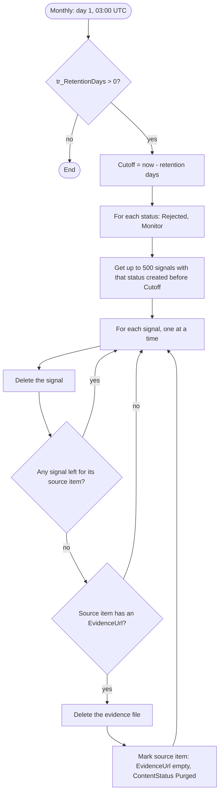

# TR Clean Up Signals: design

- **Status:** approved for planning (2026-11-02)
- **Release:** 1.4.0.0
- **Plan:** [2026-11-02-cleanup-signals-plan.md](../plans/2026-11-02-cleanup-signals-plan.md)

## Why

The classifier writes one Signal per source item and brief. Most signals are `Rejected` (relevance under 40) or `Monitor` (40 to 69), and nothing ever reads them again after a few weeks. They pile up in **Signals**, and their evidence files pile up in **Evidence**, until the lists hit the 5,000-item query threshold and the existing `$filter`s start failing.

## What it does

Once a month, a new flow, **TR Clean Up Signals** (es `VT Limpiar Señales`), deletes old `Rejected` and `Monitor` signals. When a deleted signal was the last one for its source item, the flow also deletes that item's evidence file.

| | Rule |
|---|---|
| **Deleted** | Signals with `Status` `Rejected` or `Monitor`, created more than `tr_RetentionDays` days ago. |
| **Kept** | `Digest` and `NeedsReview` signals, at any age. |
| **Evidence file** | Deleted only when **no signal at all** is left for its source item. A file that is still used by a `Digest` signal, by a `NeedsReview` signal or by a younger signal for another brief stays. It is deleted in a later month, once its last signal is gone. |
| **SourceItems row** | Never deleted. The collectors detect duplicates by `ItemKey`, so deleting the row would make RSS collect the item again and the classifier pay to reject it again. The row is kept as a tombstone: `EvidenceUrl` is set to empty and `ContentStatus` to `Purged`. |
| **Uploaded originals** | Files in `SourceUploads` belong to the customer and are never touched. |
| **Business cases, publications and drafts** | Not touched. Business cases read digests, never Signals or Evidence. |

## Settings

- **Schedule:** the 1st of each month at 03:00 UTC. This doesn't overlap the collector (11:00) or the classifier (16:00).
- **`tr_RetentionDays`** (Number, default `90`). Signals newer than this are kept. `0` turns the cleanup off.
- **Batch limit:** 500 signals per status per run. A first run on a large list catches up over the following months instead of timing out.

## Flow

The loops run one item at a time. Two signals of the same source item must not both see "no signal left" and both try to delete the file.

If one iteration fails (for example, someone already deleted the evidence file by hand), the other iterations continue and the run shows as failed. The signal is already gone at that point, and the source item keeps its old `EvidenceUrl`. That is harmless: the classifier never reads a source item again once it is `Classified`.

## SharePoint changes

When the list is over 5,000 items, the flow's queries need indexed columns:

- **Signals `Status` (`field_11`)**, for the monthly query. The weekly digest's `$filter` uses it too.
- **Signals `SourceItemId` (`field_1`)**, for the "any signal left" check.

New sites get both indexes from the SharePoint kit. Existing sites add them by hand (*List settings → Indexed columns*). The quickstart's upgrade section says how.

A query stays under the threshold while each status has fewer than 5,000 items newer than the cutoff. With monthly cleanup and 90 days of retention, that is roughly 55 rejected signals a day. A customer who goes past it should lower `tr_RetentionDays`.

## Out of scope

- Deleting `Digest` signals, publications or business-case drafts.
- Deleting SourceItems rows.
- Recovering items from the recycle bin.
- Notifications or summary reports. The run history is the audit trail.

## To verify in a tenant (acceptance)

1. Deleted signals and evidence files land in the site recycle bin, so they can be restored for 93 days.
2. The shapes of `DeleteItem`, `DeleteFile` and `GetFileMetadataByPath` match a real export. The snippets are `verified: false` until this check.
3. `GetFileMetadataByPath` accepts the `EvidenceUrl` value as written by `CreateFile` (`body/Path`).
4. A run with `tr_RetentionDays` set to `1` deletes only the old `Rejected` and `Monitor` signals. A source item that still has a `Digest` signal keeps its evidence file.
