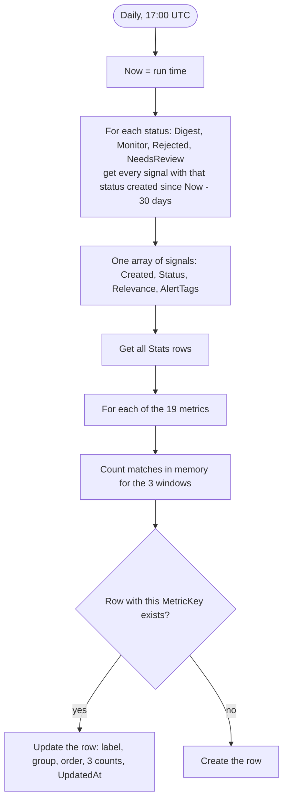

# TR Stats: design

- **Status:** for approval (2026-11-03)
- **Release:** 1.5.0.0

## Why

The person who sets up a customer (us, or the customer's admin) needs to see whether the classifier sorts items the way the customer wants. Two things need tuning:

- the prompt;
- the relevance thresholds, which decide `Rejected` (under 40), `Monitor` (40 to 69) and `Digest` (70 and over).

Some typical readings:

- **Too many `Monitor` signals:** the thresholds or the prompt need changing.
- **An alert tag fires on everything, or never:** the tag definitions in the prompt need changing.
- **Many `NeedsReview` signals:** the model is inventing tags or objectives outside the allowed lists, so the prompt's instructions are unclear.

SharePoint lists can't run grouped or aggregate queries for a page. So one flow counts once a day and writes the numbers to a small **Stats** list. The site home shows that list.

## Goals

- A **Stats** list of about 19 rows that can be read at a glance on the site home.
- Each row has three numbers: **last 7 days**, **previous 7 days** and **last 30 days**. Comparing the first two columns shows whether a change made this week helped.
- Relevance thresholds that can be tuned without editing a flow.

## Non-goals

- No history, trend lines or charts provisioned by us. A customer can point a Quick chart web part at the list themselves.
- No per-brief breakdown. A filtered view on **Signals** (by `BriefId`) answers that when needed.
- No objective counts, pipeline-health counters, source-item volume or percentages.
- Other flows don't update counters. Only the new flow writes to **Stats**.

## Anti-goals

- Counters that drift. Every run recounts from **Signals**, so manual status edits and deletions are always reflected the next day.
- Any change to how existing signals are classified. The new threshold variables only affect signals classified after they change.

## The Stats list

The list is named `Stats` (es `Estadísticas`; the URL stays `Lists/Stats`), with internal names readable and new in 1.5.0.0.

| Column (internal name) | Type | Content |
|---|---|---|
| `Title` | Text | Row label, in the site's language, for example `Signals: Monitor`. The flow writes it, so it is translated. |
| `MetricKey` | Text, unique, indexed | Stable key, for example `status-Monitor`. The flow finds its row by this key. |
| `MetricGroup` | Text | Label of the row's group: `Signals`, `Relevance` or `Alert tags`, translated. |
| `SortOrder` | Number | Display order, from 1 to 19. |
| `Last7Days` | Number | Signals created in the last 7 days that match the row. |
| `Previous7Days` | Number | Signals created 14 to 7 days ago that match the row. |
| `Last30Days` | Number | Signals created in the last 30 days that match the row. |
| `UpdatedAt` | DateTime | Time of the run that wrote the row. |

### Rows

| SortOrder | MetricKey | Counts signals where | en label |
|---|---|---|---|
| 1 | `signals-total` | always | Signals: total |
| 2 | `status-Digest` | `Status` = `Digest` | Signals: Digest |
| 3 | `status-Monitor` | `Status` = `Monitor` | Signals: Monitor |
| 4 | `status-Rejected` | `Status` = `Rejected` | Signals: Rejected |
| 5 | `status-NeedsReview` | `Status` = `NeedsReview` | Signals: NeedsReview |
| 6–15 | `relevance-0` … `relevance-9` | relevance in bucket *n*: `min(floor(Relevance / 10), 9)`, so 100 falls in bucket 9 | Relevance 0–9 … Relevance 90–100 |
| 16 | `tag-CompetitorLaunch` | `AlertTags` contains `CompetitorLaunch` | Alert tag: CompetitorLaunch |
| 17 | `tag-RegulatoryAlert` | `AlertTags` contains `RegulatoryAlert` | Alert tag: RegulatoryAlert |
| 18 | `tag-NewTechnology` | `AlertTags` contains `NewTechnology` | Alert tag: NewTechnology |
| 19 | `tag-Any` | `AlertTags` is not empty | Alert tag: any |

The status codes and tag codes stay untranslated in the labels, because they are the values people filter on. The prefixes ("Signals:", "Alert tag:") and the group labels are translated.

**How to read the relevance rows:** each threshold sits between two buckets. Moving `Digest` from 70 to 75 would move about half of the `relevance-7` row into `Monitor`.

## The flow: TR Refresh Stats

The flow is named `TR Refresh Stats` (es `VT Actualizar Estadísticas`).

- **Schedule:** daily at 17:00 UTC, one hour after TR Classify Items. A person can also start it by hand from the flow page.
- **Windows** are measured from the run's start time `Now`, on the signal's `Created`:
  - Last 7 days: `Created >= Now − 7d`.
  - Previous 7 days: `Now − 14d <= Created < Now − 7d`.
  - Last 30 days: `Created >= Now − 30d`.
- **One read of Signals per status.** Each query filters on `Status` (`field_11`, indexed since 1.4.0.0) and `Created`, with pagination turned on. Counting happens in memory. There is no SharePoint query per metric.
- **Rows are created by the flow.** No seed data is needed, and a deleted row comes back on the next run. The flow rewrites the label, group and order on every run, so a row always shows the current version's text.
- **Single writer.** Only this flow writes to **Stats**, and one run at a time (trigger concurrency 1), so nothing collides.

## Tunable thresholds

TR Classify Items currently hard-codes 40 and 70 in its `Status` expression. Two new environment variables (type Number) replace them:

| Variable | Default | Meaning |
|---|---|---|
| `tr_RejectBelow` | `40` | A relevance below this value gives `Rejected`. |
| `tr_DigestFrom` | `70` | A relevance at or above this value gives `Digest`. Values in between give `Monitor`. |

The defaults keep the current behavior. The `NeedsReview` rule for invalid tags is unchanged and still checked first. If `tr_RejectBelow` is greater than `tr_DigestFrom`, no signal can get `Monitor`; the quickstart warns about this and the flow does not check it. The thresholds are not part of `AnalysisKey`. Changing them does not reclassify old items.

## Site home

The SharePoint kit does not create views or pages, so the quickstart explains it in steps:

1. Edit the site home and add a **List** web part pointing to **Stats**.
2. Create a view sorted by `SortOrder` that shows `Title`, `Last7Days`, `Previous7Days`, `Last30Days` and `UpdatedAt`, optionally grouped by `MetricGroup`.

## Limits

- **5,000-item threshold.** Each status query is narrowed first by the `Status` index. It works while each status has fewer than 5,000 signals in the list in total, not only in the window. This is the same limit as TR Clean Up Signals. `Rejected` and `Monitor` stay bounded by the retention cleanup; `Digest` grows forever and is the one to watch in large deployments. When a status passes 5,000, the run fails at that status's query and **Stats** keeps the previous day's numbers (its `UpdatedAt` stops moving). The quickstart describes this symptom.
- **Short retention.** If `tr_RetentionDays` is under 30, the cleanup deletes `Rejected` and `Monitor` signals before they leave the 30-day window, so `Last30Days` undercounts them.
- **Out-of-range relevance.** A missing relevance counts in `signals-total` and in its status row, but in no relevance bucket. A relevance outside 0 to 100 is clamped into bucket 0 or 9.

## Left to the builder

- How the counting is laid out in the flow (`Filter array` per metric and window, `Select` projections, and so on), as long as there is one read per status and no query per metric.
- Pagination settings for the status queries.
- The Spanish labels, which follow the existing es glossary.

## To verify in a tenant (acceptance)

1. On a site with signals of every status, the 19 rows appear after the first run. Their `Last30Days` values match a manual filter on **Signals**.
2. Deleting a Stats row brings it back on the next run.
3. Setting `tr_DigestFrom` to `75` changes the status of signals classified afterwards and leaves existing ones untouched.
4. The List web part on the site home shows the view in the order of `SortOrder`.
