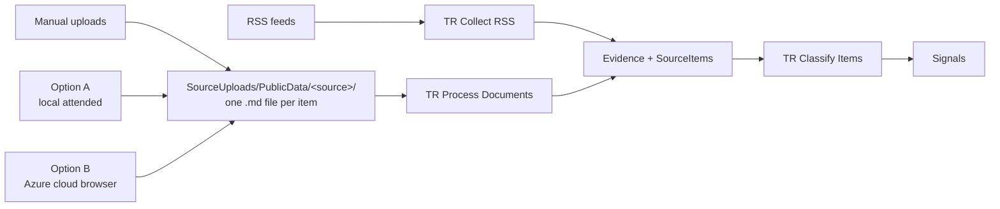
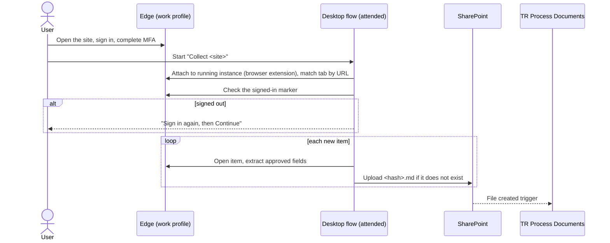
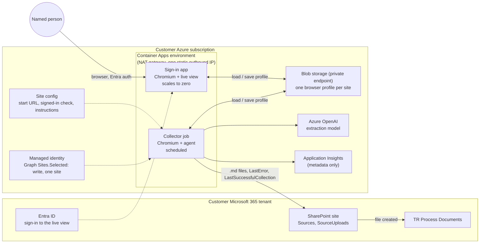
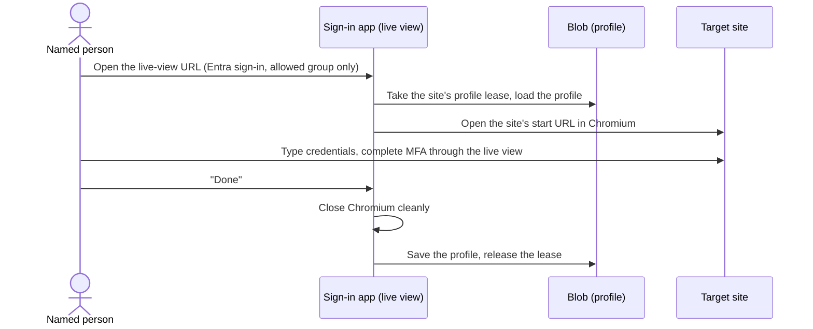
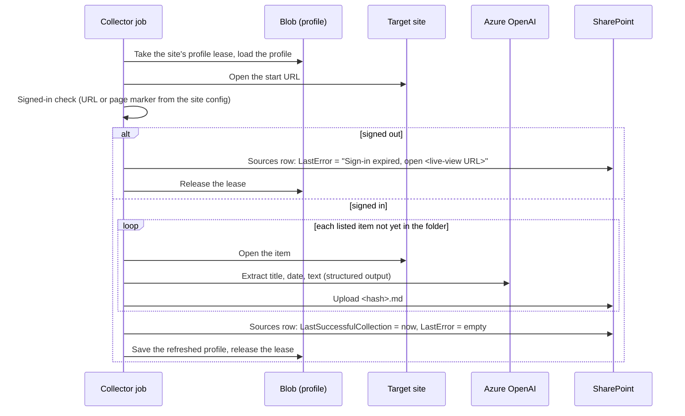

# TR Collect Browser: design options

- **Status:** options narrowed (2026-11-03). No plan yet. A plan comes when a customer names the sites.
- **Origin:** [brainstorm/TR Process Browser.md](../../../../brainstorm/TR%20Process%20Browser.md) (the original discussion, kept as written) and the browser-use sample in [microsoft/ai-agents-for-beginners, lesson 15](https://github.com/microsoft/ai-agents-for-beginners/blob/main/15-browser-use/15-browser-user.ipynb).

## Why

Some sources a customer cares about have no RSS feed and no API. They sit behind a login: paid research portals, industry associations, partner extranets. Today the only way in is a person copying text into `SourceUploads` by hand.

We want those pages in the same pipeline as everything else: Evidence, then SourceItems, then TR Classify Items. Everything that is kept lands in the customer's SharePoint.

## The constraint that decides it: MFA

Most of these sites require MFA, and some use company SSO. So:

- **A person must complete the sign-in.** No option may store a password and replay it.
- **A person must sign in again when the session expires.** Sessions last from hours to a few weeks, depending on the site. The design must notice the expiry and ask for a new sign-in instead of failing silently.

That rules out every option that needs no human at sign-in time.

## Options considered

| # | Option | Who signs in | Runs without a person present? | Verdict |
|---|---|---|---|---|
| A | **Local attended:** Power Automate for desktop, or Copilot Studio Computer Use, on the user's PC, driving the browser the user signed into | The user, in their own browser | No. The PC must be on and unlocked, and the user starts the run (or is at least signed in). | **Kept** |
| B | **Azure cloud browser add-on:** a browser in the customer's Azure. A person signs in once through a live view; scheduled runs reuse the saved profile | A named person, through the live view | Yes, until the session expires | **Kept** |
| C | Copy the user's cookies or session tokens from their PC into a cloud service | Nobody, after the copy | Yes | **Rejected.** Exports session tokens off the managed device. Device- or IP-bound sessions break anyway. |
| D | Service account with a stored password (Key Vault) | The automation | Yes | **Rejected.** MFA and CAPTCHA block it. Only fits sites with no MFA, which we don't expect. |
| E | The browser-use notebook as written: fresh temporary profile, no sign-in | Nobody | Yes | **Rejected** for logged-in sites. It closes login prompts instead of handling them. Its agent idea is reused in option B. |
| F | A browser-use Python script on each user's PC, attached to their Chrome over CDP | The user | No | **Rejected.** Same human-present limit as A, plus Python, a debug port and an unmanaged script on every PC. A covers it with Microsoft-managed tools. |

## Shared output contract

Both kept options write the same thing to the same place, so neither needs a change to the Trend Researcher solution.

- **One `.md` file per extracted item** (article, report, post), not one file per run. The classifier works per item.
- **File name from a stable key**, for example a short hash of the item's canonical URL: `<hash>.md`. The adapter skips an item whose file already exists. TR Process Documents dedupes on the file's list item ID, so the adapter must never upload the same item under a new name.
- **File content:** a small header (title, source URL, published date if shown, extracted at, extracted by), then the text as Markdown. Under `tr_MaxUploadBytes` (default 1 MB), or the file becomes `MetadataOnly`.
- **Sources row:** one `Upload` row per site, with `SourcePath` set to its folder, as for any upload source.
- **Public or private:** content behind a login is usually licensed third-party text, not personal or customer-confidential data. It goes to `PublicData`. If a site's pages can contain personal data, that site waits for the [Document Sanitizer](../../../../docs/addons/document-sanitizer-design.md) and writes to `PrivateData` instead.
- **Never written:** passwords, cookies, tokens, screenshots of signed-in pages, or anything outside the approved fields.

## Option A: local attended (Power Automate for desktop or Computer Use)

The user signs into the site in their normal Edge work profile, with MFA. An attended automation on the same Windows session drives that browser, extracts the items, and uploads the `.md` files to SharePoint. The session never leaves the PC.

**Two ways to build it:**

| | Power Automate for desktop | Copilot Studio Computer Use |
|---|---|---|
| How it reads the page | DOM selectors and web actions, built per site | A vision model reads screenshots and decides what to click |
| Predictable | Yes, until the site's layout changes | Varies by task; can get stuck or repeat steps |
| Effort per new site | A desktop flow per site | Written instructions per site |
| Session | Attaches to the user's running Edge through the Power Automate browser extension (not WebDriver mode, which only attaches to browsers it launched) | Runs on a registered machine; using the user's own signed-in browser needs that machine to be the user's PC |
| Cost | Power Automate Premium, USD 15 per user per month (list price, annual) | Billed per step as agent actions in Copilot Credits (USD 0.01 per credit pay-as-you-go). Not included in the Microsoft 365 Copilot licence. |
| Screens leave the PC | No | Screenshots go to the model and appear in the activity log |

Our call: start with **Power Automate for desktop**. It is cheaper per run, deterministic, and keeps signed-in screens on the PC. Use Computer Use only for a site where selectors don't work (canvas rendering, constantly changing layout).

**Limits:** collection happens only when the user runs it. Holidays and sick days mean gaps. Each user who collects needs the Premium licence and the extension deployed through Intune.

## Option B: Azure cloud browser add-on

A customer-hosted add-on, shipped like the Document Sanitizer ([ADR-001](../../../../docs/addons/adr-001-document-sanitizer-distribution.md), option A): the customer deploys it into their own Azure subscription. Unlike the sanitizer, it needs **no custom connector and no change to the solution**: it writes files into `SourceUploads`, and the existing flow does the rest.

### Components

### Sign-in (once, and again after each expiry)

### Scheduled run

### Design points

- **The human step is explicit.** The add-on never types a password. A named person owns each site's sign-in and is the one asked to renew it.
- **Expiry is visible in SharePoint.** The job writes `LastError` on the site's Sources row. A SharePoint alert on the Sources list ("when items change") tells the owner by email, with no extra connector or Graph mail permission.
- **One browser at a time per profile.** A blob lease stops the sign-in app and the job from opening the same profile together, which would corrupt it.
- **Same outbound IP for sign-in and runs.** Both run in one Container Apps environment behind a NAT gateway. Many sites end a session that suddenly comes from a different IP. A fixed IP also lets a site allowlist it.
- **The profile is a credential.** It holds live session cookies. Chrome on Linux has no OS keyring in a container, so its cookie encryption protects nothing; the protection is the storage account: private endpoint, no shared keys, RBAC for the two managed identities only.
- **Least privilege to SharePoint.** The job's managed identity gets Microsoft Graph `Sites.Selected` with write on the Trend Researcher site only. It writes files into `SourceUploads/PublicData/<source>/` and two fields on Sources rows.
- **Agent or script.** The browser-use agent (vision plus an LLM deciding clicks) needs only written instructions per site and survives layout changes better, but costs model tokens per page and is less predictable. A Playwright script per site is cheap and predictable but breaks on redesigns. Our call: Playwright navigation to the list of items, and the model only for extracting each item's text into the structured output. The builder may use the browser-use agent for a site whose navigation can't be scripted.
- **Why Container Apps, not Functions:** Chromium needs a custom container image, a live view needs WebSockets, and a run can take many minutes. A Container Apps job covers the schedule, and the sign-in app scales to zero between sign-ins.

### Cost (estimate, to confirm per customer)

- Container Apps: a short daily job plus an idle-at-zero sign-in app. Small.
- NAT gateway and its static IP: a fixed monthly charge, the largest fixed item.
- Azure OpenAI: per extracted page. A mini model keeps it to cents per run for a few dozen items.
- Storage, Application Insights: negligible.
- No Power Platform licence beyond what Trend Researcher already needs.

## Comparison of the kept options

| | A: local attended (PAD) | B: Azure cloud browser |
|---|---|---|
| Collects on a schedule with nobody at a PC | No | Yes |
| Human work | Sign in and start each run | Sign in once per session lifetime |
| Session lives | On the user's PC | In the customer's Azure storage |
| Install | Premium licence and Edge extension per collecting user | One Azure deployment per customer |
| Per-site work | A desktop flow | A site config, maybe a navigation script |
| Changes to the Trend Researcher solution | None | None |
| Main risk | Gaps when the user doesn't run it | Site blocks datacenter IPs or shows CAPTCHAs to automation |

## Controls for both options

- **Site authorization first.** Check each site's terms of service and account agreement for automated access, rate limits and permitted use. A valid human account does not by itself authorize automation. This is the customer's legal call, recorded per site.
- **A dedicated account per site where the site allows it,** owned by a named person, rather than a personal account shared across people.
- **Only approved fields** leave the page. No screenshots of signed-in pages are stored.
- **Read only.** No automation submits forms, accepts terms, buys or posts anything on the site.
- **Option A:** managed Windows device, Edge work profile, extension deployed by Intune, Power Platform DLP with SharePoint in the Business group.
- **Option B:** live view behind Entra ID with a restricted group, private storage, metadata-only logging, domain allowlist on the job's outbound traffic where the network allows it.

## Recommendation

1. **Pilot one site with option A** (Power Automate for desktop). It needs no Azure, proves the output contract end to end, and shows how long the site's session lasts.
2. **Build option B as an add-on** when a customer wants daily unattended collection and accepts a person renewing the sign-in when asked. It reuses the pilot's output contract and site config.

Copilot Studio Computer Use stays a fallback for a site that neither selectors nor scripted navigation can handle.

## Open questions (for the customer)

1. Which sites, and how people sign in to each today (MFA type, SSO)?
2. How long each site's session lasts before it asks for MFA again.
3. Whether each site's terms allow automated access, and whether its pages can contain personal data (which decides `PublicData` or `PrivateData`).
4. Who owns the sign-in for each site.

## Left to the builder

- The live-view technology (for example Xvfb with noVNC, or a DevTools screencast page).
- Profile format: a full persistent profile archive or Playwright `storage_state`, as long as sign-in survives between runs.
- The site config format and where it lives in the add-on.
- The header fields in each `.md` file, within the contract above.
